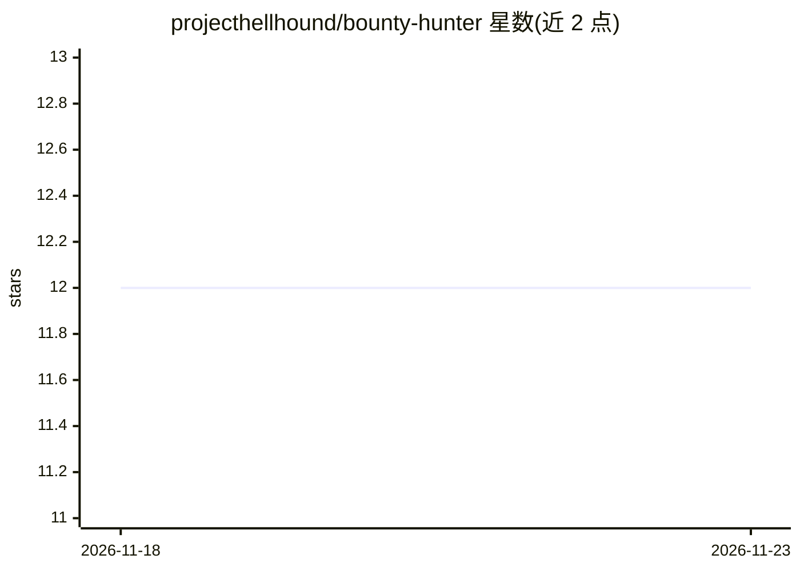

# projecthellhound/bounty-hunter

⭐ 12 · Python · GPL-3.0 · 推送 2026-11-22 · [GitHub](https://github.com/projecthellhound/bounty-hunter) · 组织维护

**自主漏洞赏金/渗透测试 AI agent：从侦察到利用到报告**

面向漏洞赏金猎人、渗透测试者与 CTF 选手的自主 agent：用自然语言下达目标后，自动执行侦察、漏洞利用（无头浏览器中真实触发 alert 验证 XSS、SSRF 到云元数据凭证、IDOR 链接账户接管）、按类别的 verify_finding 实证校验，并生成可提交的报告。带不可绕过的 scope gate 限制越界请求，按目标持久化黑板状态支持跨会话恢复，可中途学习 15k+ HackerOne 公开报告。当前在训练靶场可端到端自主完成，生产目标结果需人工复核。安装为 shell 脚本或 git clone。

## 筛选速览

| 维度 | 判定 | 备注 |
|---|---|---|
| AI 角色 | `ai-native` | 本体是模型或模型工具 |
| 许可风险 | `viral` | GPL-3.0 |
| 部署形态 | `None` |  |
| 模型依赖 | local-ok | 支持本地模型 |
| 硬件要求 | — | 无带数字的原话,不猜 |
| 安装摩擦 | `low` | 无编译、无系统依赖或容器化 |
| 成熟度 | `idea` | |

## 能力要点

- 侦察→利用→验证→报告的自主流程，拒绝记录无法实证的发现
- scope gate 对每个网络调用做范围校验，越界目标无条件阻断
- 支持 NVIDIA NIM 免费额度、Claude/Gemini/OpenAI 商业 API 及 Ollama 本地离线运行
- Orchestrator/Synthesizer 双角色可指向同一或不同模型，支持 MCP 接入 Burp/Caido

## 适用场景

- 在授权的漏洞赏金项目上做侦察、分诊与漏洞验证
- 训练靶场（PortSwigger、HackTheBox 等）的端到端自主解题
- 离线/隔离环境下的本地模型渗透测试流程
- 通过 benchmarks/score.py 以 ground-truth 文件量化召回与误报

## 场景标签

`网络安全` · 领域:学习与行业

## 证据(README 行号)

> L40: **Bounty Hunter** (nickname **"Beast"**) is an **autonomous AI agent for bug bounty and penetration testing**, buil
> L7:  Point it at a target in plain English. It runs the recon, finds and exploits the bug — XSS proven by a real <code>a

## 星数曲线

2026-11-18 12 → 2026-11-23 12（+0）

---
*卡片 v1 · prompt 1.4 · 生成 2026-11-18 · 置信度 high · 依据 README sha `4081db16f779` · [字段定义](../../DATASET.md)*
