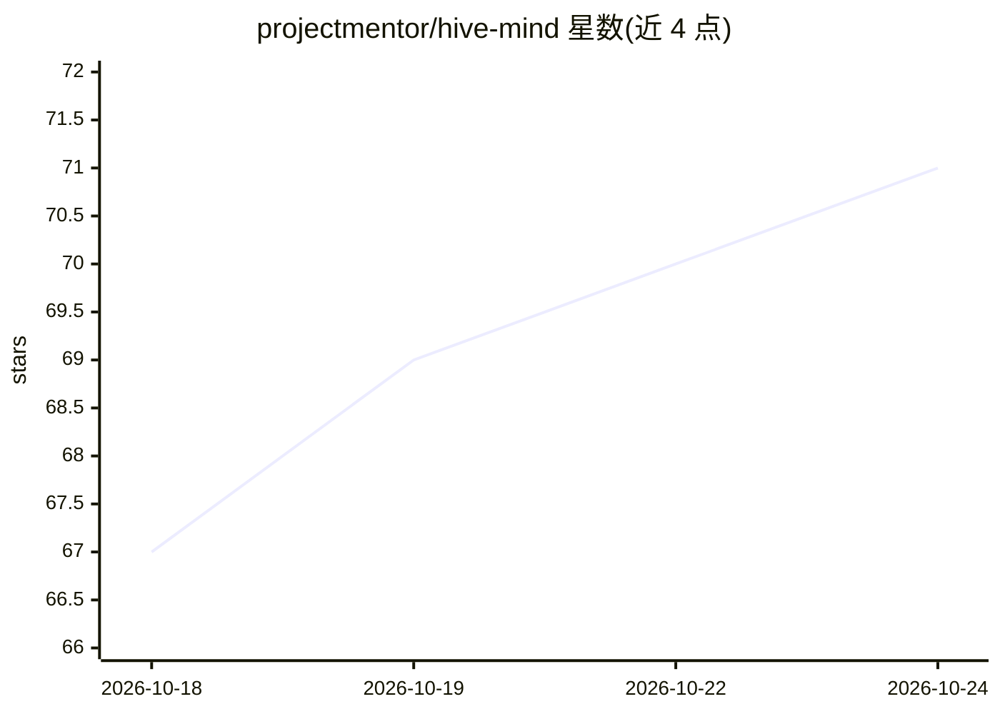

# projectmentor/hive-mind

⭐ 73 · Python · AGPL-3.0 · 推送 2026-10-18 · [GitHub](https://github.com/projectmentor/hive-mind) · [官网](https://hivemind.projectmentor.org) · 组织维护

**AI agent 跨机共享记忆工具：多设备无服务器同步笔记**

为 AI agent 提供去中心化共享记忆：任一 agent 写入的事实同步到其他设备，无需中间服务器。机制上采用追加式日志（含哈希链与 Ed25519 签名）、SQLite 索引与 Merkle 增量同步，经 Tailscale 私有网络在设备间复制。事实的置信度由不同设备的独立佐证派生，决策可获结果评分。支持离线运行、本地搜索、加密胶囊共享密钥，并提供只读 Web 仪表盘。可通过本地 MCP 服务器接入 Claude Code、Hermes、Claude Desktop。当前为 alpha 阶段，agent 契约（4.2）仍在变更。

## 筛选速览

| 维度 | 判定 | 备注 |
|---|---|---|
| AI 角色 | `ai-ecosystem` | LLM/agent 周边工具 |
| 许可风险 | `dual` | AGPL-3.0 |
| 部署形态 | `None` |  |
| 模型依赖 | — | README 未给出锁定关系 |
| 硬件要求 | — | 无带数字的原话,不猜 |
| 安装摩擦 | `low` | 无编译、无系统依赖或容器化 |
| 成熟度 | `idea` | |

## 能力要点

- 无服务器多设备同步，数据保存在用户自己的机器上
- 置信度由跨设备独立佐证派生，agent 自我重复不提升信任
- 追加式日志 + 哈希链 + Ed25519 设备密钥签名验证
- 决策可回溯记录所用事实并获结果评分

## 适用场景

- 多个 AI agent 在多台机器间共享项目知识与笔记
- 为 agent 团队（规划者/构建者/检查者）建立共同记忆
- 离线记录笔记，联网后自动合并同步

## 场景标签

`Agent 记忆` · 领域:Agent 开发

## 证据(README 行号)

> L3: HiveMind is shared memory for your AI agents: a fact one agent writes on one machine is there for the next agent and
> L68: - **Works with agents you already have.** Claude Code, Hermes, and Claude Desktop

## 星数曲线

2026-10-18 67 → 2026-10-24 71（+4）

---
*卡片 v1 · prompt 1.4 · 生成 2026-10-24 · 置信度 high · 依据 README sha `280ef4831277` · [字段定义](../../DATASET.md)*
