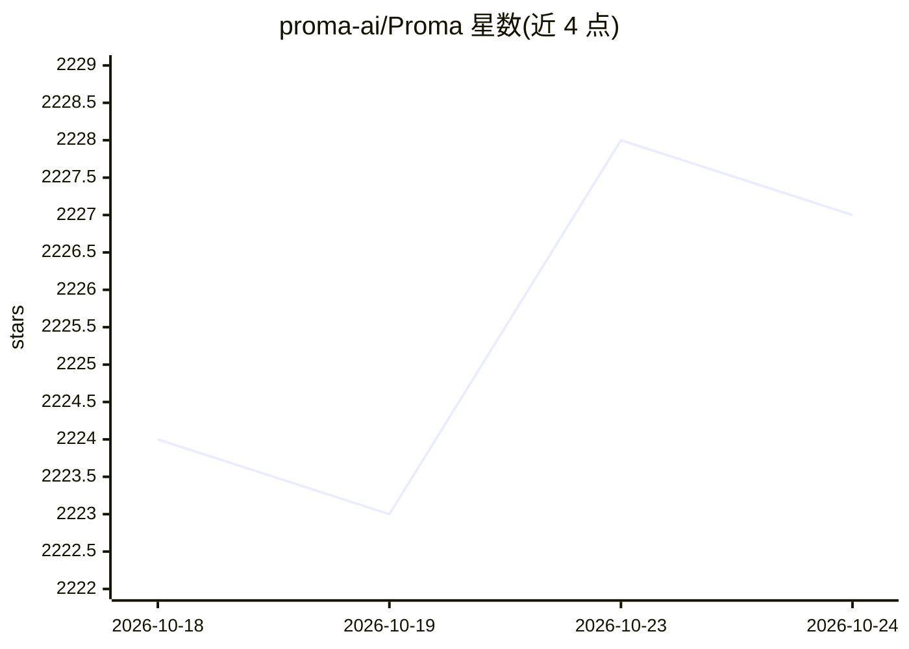

# proma-ai/Proma

⭐ 2,226 · TypeScript · AGPL-3.0 · 推送 2026-09-26 · [GitHub](https://github.com/proma-ai/Proma) · [官网](https://proma.cool/download) · 组织维护 · 中文 README

**面向专业用户的开源桌面端通用 Agent 产品**

Proma 是一款桌面端通用 Agent 应用，功能包括 Chat/Agent/计划模式、项目分区、记忆（AGENTS.md/MEMORY.md）、内嵌浏览器与终端、定时任务、探索模式（上下文分叉并可带回主线）、子会话与主会话并行、Skills/MCP/CLI 支持，并集成 Todo、日程（可同步 macOS 提醒事项与日历）、Obsidian 风格编辑器与文件预览编辑。开源版从 GitHub Releases 下载，覆盖 macOS/Windows/Linux。注意：维护方声明开源版更新放缓，主要精力投入商业版，商业版支持覆盖安装并继承数据。

## 筛选速览

| 维度 | 判定 | 备注 |
|---|---|---|
| AI 角色 | `ai-native` | 本体是模型或模型工具 |
| 许可风险 | `viral` | AGPL-3.0 |
| 部署形态 | `None` |  |
| 模型依赖 | — | README 未给出锁定关系 |
| 硬件要求 | — | 无带数字的原话,不猜 |
| 安装摩擦 | `low` | 无编译、无系统依赖或容器化 |
| 成熟度 | — | 结构信号不足 |

## 能力要点

- Chat/Agent/计划模式与子会话&主会话的并行多 Agent 交互
- 探索模式：基于前序上下文创建分叉并可将结果带回主会话
- 内嵌浏览器与终端，Agent 可直接操作
- 项目级记忆（AGENTS.md/MEMORY.md）与 Skills/MCP/CLI 按项目区分

## 适用场景

- 在桌面端统一进行对话、研究、编程与自动化任务
- 通过子会话与探索模式做深度研究和对抗性分析
- 让 Agent 管理 Todo、日程与定时任务，并与 macOS 事项同步

## 场景标签

`AI 助手` `浏览器自动化` `GUI 自动化` · 领域:效率与自动化

## 证据(README 行号)

> L13: Proma 是一款为专业用户打造的开源通用的桌面端 Agent 产品。功能涵盖了主流 Agent 具备的所有功能，包括
> L47: 从 GitHub Releases 下载开源版本，提供 macOS Apple Silicon、macOS Intel、Windows、Ubuntu/Debian x86_64 的 `.deb` 安装包和 Linux x86_64

## 星数曲线

2026-10-18 2,224 → 2026-10-24 2,227（+3）

---
*卡片 v1 · prompt 1.4 · 生成 2026-10-21 · 置信度 high · 依据 README sha `c721a5ee0e55` · [字段定义](../../DATASET.md)*
