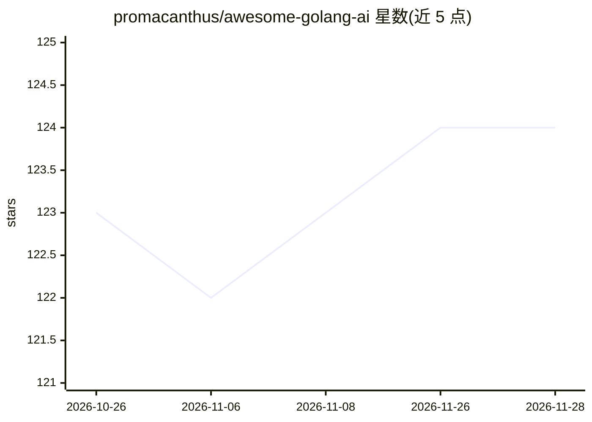

# promacanthus/awesome-golang-ai

⭐ 124 · MIT · 推送 2026-11-25 · [GitHub](https://github.com/promacanthus/awesome-golang-ai) · [官网](https://promacanthus.github.io/awesome-golang-ai/) · 个人维护

**Go 语言 AI/ML 开发资源的策展清单**

以 awesome list 形式收录使用 Go 进行 AI 与机器学习开发的资源，按基准测试、LLM 工具、RAG 组件、通用 ML 库、神经网络、MCP 实现、教程书籍等类别组织，每个条目附链接与简要说明。仓库本身不含可执行代码，仅作为发现与参考工具。面向 Go 开发者、ML 工程师、研究者、MLOps 工程师及学习者，用于浏览查找、评估模型、学习或集成资源。贡献遵循 awesome list 惯例，通过 pull request 提交条目。

## 筛选速览

| 维度 | 判定 | 备注 |
|---|---|---|
| AI 角色 | `ai-knowledge` | 知识聚合/清单类 |
| 许可风险 | `permissive` | MIT |
| 部署形态 | `None` |  |
| 模型依赖 | — | README 未给出锁定关系 |
| 硬件要求 | — | 无带数字的原话,不猜 |
| 安装摩擦 | `low` | 无编译、无系统依赖或容器化 |
| 成熟度 | — | 结构信号不足 |

## 能力要点

- 按基准、LLM、RAG、MCP、ML 库、神经网络等类别组织的资源清单
- 条目含链接与功能简述，遵循 awesome list 格式
- 提供英文与中文双语版本
- 覆盖文档解析、嵌入模型、向量数据库等 RAG 组件资源

## 适用场景

- 查找用 Go 构建生产级 AI 应用所需的库和框架
- 选用基准测试套件评估 LLM 的代码生成或推理能力
- 系统学习用 Go 实现 AI 概念的书籍和教程

## 场景标签

`精选清单` · 领域:学习与行业

## 证据(README 行号)

> L15: The repository is a curated list of resources focused on artificial intelligence (AI) and machine learning (ML) dev
> L17: This repository does not contain executable code or software projects. Instead, it serves as a discovery and refere

## 星数曲线

2026-10-26 123 → 2026-11-28 124（+1）

---
*卡片 v1 · prompt 1.4 · 生成 2026-11-28 · 置信度 high · 依据 README sha `be1bc75d1861` · [字段定义](../../DATASET.md)*
