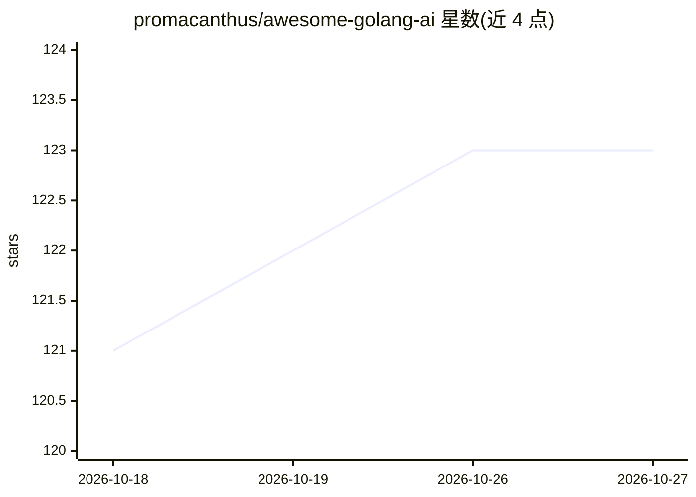

# promacanthus/awesome-golang-ai

⭐ 123 · MIT · 推送 2026-10-14 · [GitHub](https://github.com/promacanthus/awesome-golang-ai) · [官网](https://promacanthus.github.io/awesome-golang-ai/) · 个人维护 · 中文 README

**Go 语言 AI/ML 资源策展清单：工具、库、基准与教程聚合**

遵循 awesome list 格式的 Go 语言 AI/ML 资源聚合仓库，不含可执行代码，作为发现与参考工具。条目按基准评测、MCP 实现、LLM 工具、RAG 组件、通用机器学习库、神经网络、专用领域与教育材料等类别组织，每条含链接与功能简介。面向 Go 开发者、ML 工程师、研究人员、DevOps/MLOps 工程师与学生。贡献通过 PR 提交，README 声明无正式贡献指南文件。

## 筛选速览

| 维度 | 判定 | 备注 |
|---|---|---|
| AI 角色 | `ai-knowledge` | 知识聚合/清单类 |
| 许可风险 | `permissive` | MIT |
| 部署形态 | `None` |  |
| 模型依赖 | — | README 未给出锁定关系 |
| 硬件要求 | — | 无带数字的原话,不猜 |
| 安装摩擦 | `low` | 无编译、无系统依赖或容器化 |
| 成熟度 | — | 结构信号不足 |

## 能力要点

- 按基准、MCP、LLM、RAG、通用 ML 库、神经网络等类别组织条目
- 每条目提供链接与功能描述
- 覆盖教育材料：书籍、教程与数据集

## 适用场景

- 查找 Go 语言的向量数据库、LLM SDK 等 AI 工具
- 用基准条目比较模型能力或做可复现实验
- 通过教程与书籍学习 Go 实现 AI 概念

## 场景标签

`精选清单` · 领域:学习与行业

## 证据(README 行号)

> L15: The repository is a curated list of resources focused on artificial intelligence (AI) and machine learning (ML) dev
> L19: The repository is structured into well-defined categories such as benchmarks, large language model (LLM) tools, Ret

## 星数曲线

2026-10-18 121 → 2026-10-27 123（+2）

---
*卡片 v1 · prompt 1.4 · 生成 2026-10-23 · 置信度 high · 依据 README sha `3e892dfe07af` · [字段定义](../../DATASET.md)*
