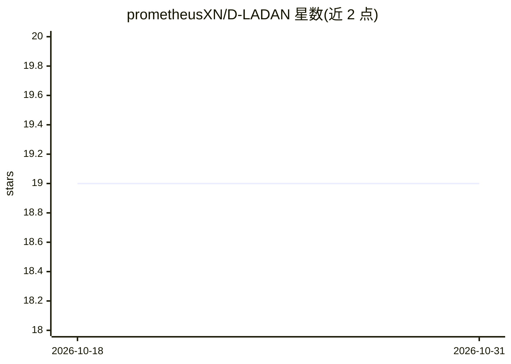

# prometheusXN/D-LADAN

⭐ 19 · Python · MIT · 推送 2026-07-01 · [GitHub](https://github.com/prometheusXN/D-LADAN) · 个人维护

**法律判决预测模型代码：区分易混淆法条与罪名**

论文 D-LADAN（TOIS，LADAN 的 ACL 2020 工作修订版）的官方源码，基于 TensorFlow 2.x 重构。针对法律判决预测中的易混淆法条/罪名问题，从先验与后验两个视角处理，引入动量更新的修正记忆机制以感知训练中学到的法条（罪名）间后验相似关系，并结合加权图蒸馏操作（GDO）提取区分性特征。提供 BERT 版本（Bert_Ladan 文件夹），数据需从 Google Drive 下载处理后放入指定文件夹，经 requirements.txt 安装依赖后用 python 脚本训练。

## 筛选速览

| 维度 | 判定 | 备注 |
|---|---|---|
| AI 角色 | `ai-native` | 本体是模型或模型工具 |
| 许可风险 | `permissive` | MIT |
| 部署形态 | `None` |  |
| 模型依赖 | — | README 未给出锁定关系 |
| 硬件要求 | — | 无带数字的原话,不猜 |
| 安装摩擦 | `low` | 无编译、无系统依赖或容器化 |
| 成熟度 | — | 结构信号不足 |

## 能力要点

- 动量更新的修正记忆机制，动态感知法条/罪名的后验相似关系
- 加权图蒸馏操作（GDO）自适应提取区分性特征
- 基于 TensorFlow 2.x 重构，并另提供 BERT 版本实现

## 适用场景

- 复现论文中的法律判决预测实验
- 研究易混淆法条/罪名区分与数据不平衡问题
- 在 CAIL 类数据集上训练/对比法律判决预测模型

## 场景标签

 · 领域:法律 NLP/科研

## 证据(README 行号)

> L2: The source code of the article "**Distinguish Confusion in Legal Judgment Prediction via Revised Relation Knowledge 
> L7: Compared with *LADAN*, our main improvement in this work is the proposed momentum-updated **revised memory mechanism

## 星数曲线

2026-10-18 19 → 2026-10-31 19（+0）

---
*卡片 v1 · prompt 1.4 · 生成 2026-10-28 · 置信度 high · 依据 README sha `627778c117d7` · [字段定义](../../DATASET.md)*
