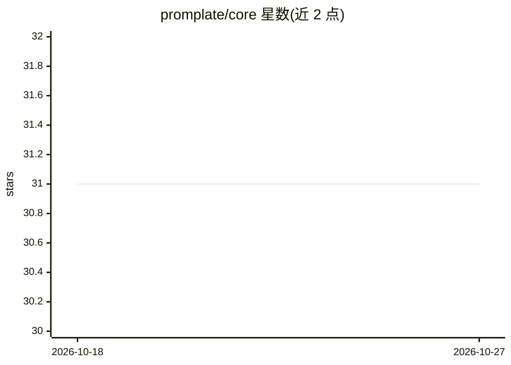

# promplate/core

⭐ 31 · Python · 推送 2025-12-04 · [GitHub](https://github.com/promplate/core) · [官网](https://docs.py.promplate.dev) · 组织维护

**面向提示词开发的 LLM 模板与有限状态机框架（Python SDK）**

Promplate 是一个提示词（prompting）框架，主打开发体验，同时可作为进行简单 LLM 调用的 SDK。其模板语言设计类似 Jinja2，支持以 .j2 文件扩展名获得语法高亮，并采用渐进式增强提示词工作流。支持 CPython 与 PyPy（3.8-3.13），可通过 Python 的 wasm 实现在浏览器中运行。代码全类型标注，配套 pytest 测试、GitHub Actions 与覆盖率报告；文档见 docs.py.promplate.dev。

## 筛选速览

| 维度 | 判定 | 备注 |
|---|---|---|
| AI 角色 | `ai-ecosystem` | LLM/agent 周边工具 |
| 许可风险 | `none` | — |
| 部署形态 | `library` | 以包/库形式分发 |
| 模型依赖 | — | README 未给出锁定关系 |
| 硬件要求 | — | 无带数字的原话,不猜 |
| 安装摩擦 | `low` | 无编译、无系统依赖或容器化 |
| 成熟度 | — | 结构信号不足 |

## 能力要点

- 类 Jinja2 语法的模板语言，可用 .j2 扩展名获得语法高亮
- 可同时作为简单 LLM 调用的 SDK
- 支持 CPython/PyPy 3.8-3.13 及浏览器 wasm 运行
- 全类型标注，兼容 pyright 静态类型检查

## 适用场景

- 以模板方式构建和管理 LLM 提示词
- 在 Python 项目中直接发起简单 LLM 调用
- 用有限状态机（FSM）组织多步提示词流程

## 场景标签

`提示工程` · 领域:Agent 开发

## 证据(README 行号)

> L7: **Promplate** is a prompting framework focusing on developing experience. However, it can also be a super-convenient
> L12: pip install promplate

## 星数曲线

2026-10-18 31 → 2026-10-27 31（+0）

---
*卡片 v1 · prompt 1.4 · 生成 2026-10-26 · 置信度 high · 依据 README sha `1badf9eddb5c` · [字段定义](../../DATASET.md)*
