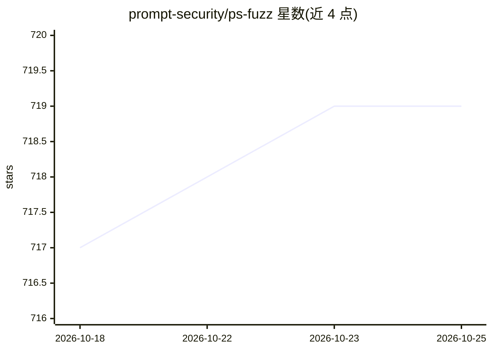

# prompt-security/ps-fuzz

⭐ 719 · Python · MIT · 推送 2026-08-19 · [GitHub](https://github.com/prompt-security/ps-fuzz) · [官网](https://www.prompt.security/fuzzer) · 组织维护

**测试与加固 GenAI 应用系统提示词安全的开源模糊测试工具**

由 Prompt Security 公司维护的交互式 CLI 工具：针对用户提供的系统提示词，运行动态生成的 LLM 攻击模拟（16 种攻击，涵盖越狱、提示注入、RAG 投毒 Hidden Parrot、系统提示词窃取），并给出安全评估结果（Broken/Resilient/Errors 判定）；附带 Playground 聊天界面供迭代加固提示词。声称 LLM 无关（agnostic），支持 16 个 LLM 提供商（OpenAI/Anthropic/Azure/Cohere 等）及 Ollama 自托管端点，支持交互与批处理模式、多线程测试与 RAG 测试（依赖默认安装的 chromadb）。使用会消耗 token。

## 筛选速览

| 维度 | 判定 | 备注 |
|---|---|---|
| AI 角色 | `ai-ecosystem` | LLM/agent 周边工具 |
| 许可风险 | `permissive` | MIT |
| 部署形态 | `library` | 以包/库形式分发 |
| 模型依赖 | local-ok | 支持本地模型 |
| 硬件要求 | — | 无带数字的原话,不猜 |
| 安装摩擦 | `low` | 无编译、无系统依赖或容器化 |
| 成熟度 | — | 结构信号不足 |

## 能力要点

- 16 种攻击类型：越狱、提示注入、RAG 投毒（Hidden Parrot）、系统提示词窃取
- 声称 LLM agnostic，列出 16 个 LLM 提供商及自托管 Ollama 端点支持
- 交互模式与批处理/CLI 模式，支持多线程与自定义 benchmark、攻击子集
- Playground 聊天界面迭代加固系统提示词；提供 Google Colab Notebook

## 适用场景

- 上线前对我的 GenAI 应用的系统提示词做攻击模拟测试
- 验证 RAG 系统对向量库投毒攻击的抵抗情况
- 在自托管 Ollama 环境下批量测试提示词安全性

## 场景标签

`网络安全` `提示工程` · 领域:Agent 开发

## 证据(README 行号)

> L25: 1. This interactive tool assesses the security of your GenAI application's system prompt against various dynamic LL
> L79:  We're fully LLM agnostic. (Click for full configuration list of llm providers)

## 星数曲线

2026-10-18 717 → 2026-10-25 719（+2）

---
*卡片 v1 · prompt 1.4 · 生成 2026-10-21 · 置信度 high · 依据 README sha `57975661ab8a` · [字段定义](../../DATASET.md)*
