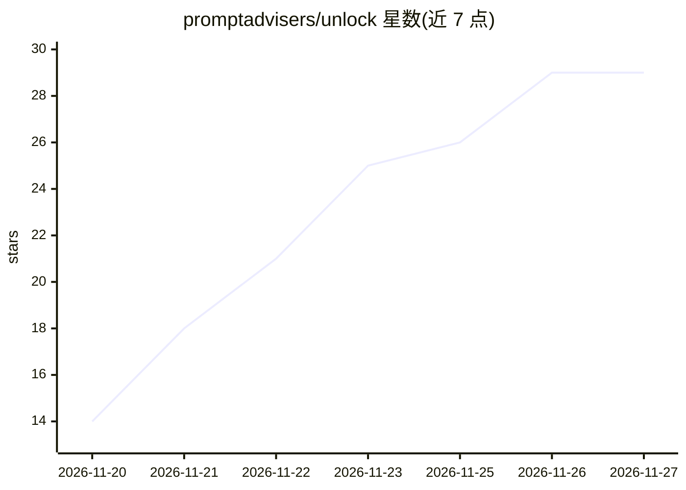

# promptadvisers/unlock

⭐ 29 · Python · AGPL-3.0 · 推送 2026-11-18 · [GitHub](https://github.com/promptadvisers/unlock) · 个人维护

**通过 Claude Code/Codex 编辑本地模型行为的技能：改副本、留原件**

Unlock 是一组安装到 Claude Code 或 Codex 技能目录的指令与辅助脚本，底层调用 Heretic 模型编辑工具。用户用一条自然语言请求描述模型与改动，助手完成环境检查、模型下载、编辑、重载与前后对比；编辑采用 abliteration 技术（残差流方向定位并削弱），仅在副本上修改权重，原始模型文件保持只读。每次运行生成 HTML 报告、原始回复、输入 token 记录与文件指纹。需 git 与 uv，本机需能容纳目标模型。

## 筛选速览

| 维度 | 判定 | 备注 |
|---|---|---|
| AI 角色 | `ai-ecosystem` | LLM/agent 周边工具 |
| 许可风险 | `viral` | AGPL-3.0 |
| 部署形态 | `None` |  |
| 模型依赖 | — | README 未给出锁定关系 |
| 硬件要求 | — | 无带数字的原话,不猜 |
| 安装摩擦 | `medium` | 含编译或系统依赖之一 |
| 成熟度 | — | 结构信号不足 |

## 能力要点

- 驱动 Heretic 执行 projected abliteration 权重编辑，保留原始模型文件不变（哈希验证）
- 运行前后同题对比：相同系统消息、问题与贪心设置，记录精确输入 token
- 候选编辑按停止拒答与 KL 散度漂移两项打分，保留漂移最小者
- 每次运行输出单页 HTML 报告及原始回复、版本与指纹存档

## 适用场景

- 让本地小模型回答原本拒绝回答的问题并保留对照副本
- 验证模型编辑只影响目标行为、其他任务表现不变
- 为教学场景生成可分享的模型修改前后对比报告

## 场景标签

`微调` · 领域:训练与推理

## 证据(README 行号)

> L7: Built on Heretic
> L14: Unlock is the skill that did that. It is a set of instructions and helper scripts for Claude Code and Codex. Your a
> L16: The edit itself is done by **Heretic**, the open-source model editing tool by Philipp Emanuel Weidmann. Unlock does

## 星数曲线

2026-11-20 14 → 2026-11-27 29（+15）

---
*卡片 v1 · prompt 1.4 · 生成 2026-11-20 · 置信度 high · 依据 README sha `58ff182e3313` · [字段定义](../../DATASET.md)*
