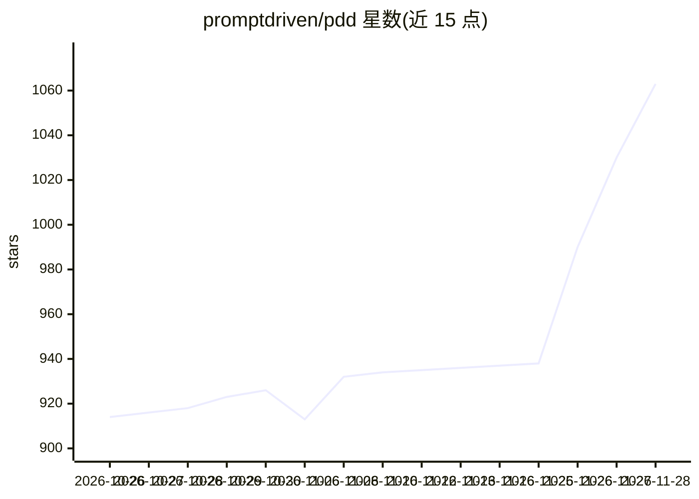

# promptdriven/pdd

⭐ 1,063 · JavaScript · MIT · 推送 2026-11-27 · [GitHub](https://github.com/promptdriven/pdd) · [官网](https://promptdriven.ai) · 组织维护

**给开发者的提示驱动开发 CLI：以提示为源，先验行为再生成代码**

pdd 是一个 npm 分发的 CLI 与单个 /pdd skill，推行提示先行的开发流程：prompts 与 Story 作为源文件，在编码代理写代码前先通过 Prompt Interpreter 运行、lint 和测试提示以验证行为，再由编码代理从已批准的提示生成实现并用 pdd prove 验证。工作流分 product/bug/feature/small-change 四种模式，提示变更需在聊天或 GitHub PR 中人工审批；CLI 无合并命令，需依赖外部编码代理（Codex、Claude Code、Gemini CLI 等）完成写码与合并。远程测试依赖 PDD 解释器服务，会话有 AI 调用预算与 24 小时时限。

## 筛选速览

| 维度 | 判定 | 备注 |
|---|---|---|
| AI 角色 | `ai-ecosystem` | LLM/agent 周边工具 |
| 许可风险 | `permissive` | MIT |
| 部署形态 | `library` | 以包/库形式分发 |
| 模型依赖 | — | README 未给出锁定关系 |
| 硬件要求 | — | 无带数字的原话,不猜 |
| 安装摩擦 | `low` | 无编译、无系统依赖或容器化 |
| 成熟度 | — | 结构信号不足 |

## 能力要点

- prompts/Story 作为源文件，代码由批准的提示生成
- pdd lint 离线运行，0 AI 调用 0 网络调用
- pdd STORY 支持浏览器、CLI（--cli）与 HTTP（--serve）三种试运行方式
- AI 调用按预算封顶，新会话默认 400 次

## 适用场景

- 在写代码前先验证功能行为是否符合预期
- 以 Story 验收标准驱动的功能开发与缺陷修复
- 多部分产品的契约与计划管理（product 模式）

## 场景标签

`提示工程` `代码生成` · 领域:Agent 开发

## 证据(README 行号)

> L16: PDD is the `pdd` command and one `/pdd` skill (`$pdd` in Codex, `/pdd` in Claude Code) with on-demand references fo
> L20: You need Node.js 22.16.0 or newer (22.20.0+ for Autopilot), Git, and the GitHub CLI signed in with `gh auth login`.

## 星数曲线

2026-10-26 914 → 2026-11-28 1,063（+149）

---
*卡片 v1 · prompt 1.4 · 生成 2026-11-28 · 置信度 mid · 依据 README sha `4593abe64438` · [字段定义](../../DATASET.md)*
