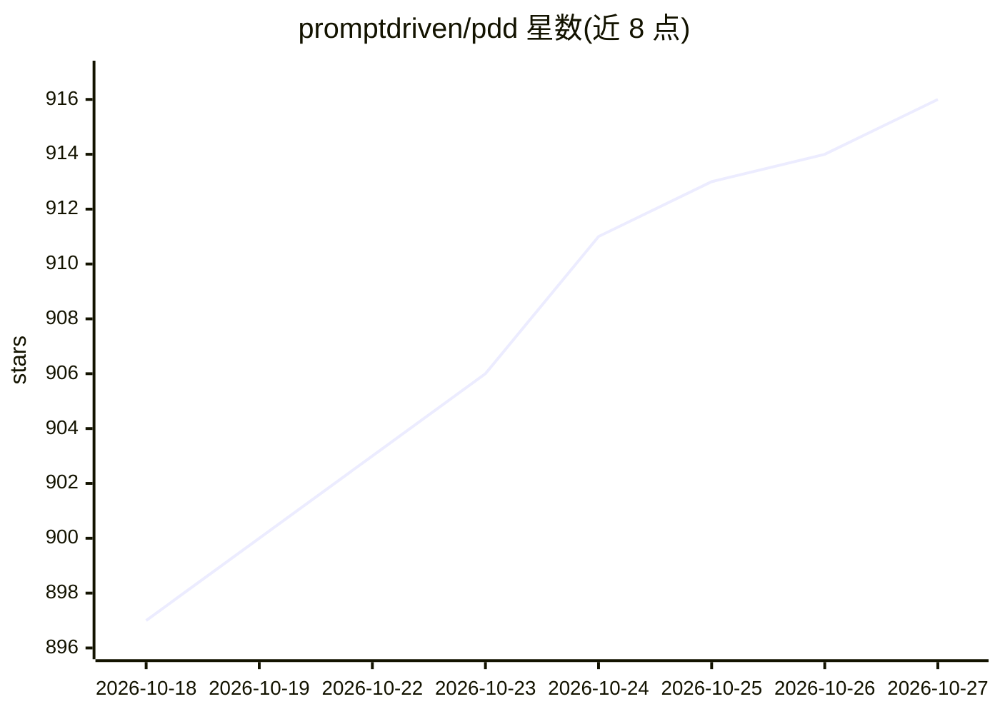

# promptdriven/pdd

⭐ 916 · Python · MIT · 推送 2026-10-26 · [GitHub](https://github.com/promptdriven/pdd) · [官网](https://promptdriven.ai) · 组织维护

**以 .prompt 文件为源码、由 LLM 生成实现代码的开发系统**

Prompt-Driven Development 的 CLI 与 Web 工具：开发者以 .prompt 文件编写意图、约束、示例与测试，由 LLM 将其编译为 Python/TypeScript/Go 等实现代码；代码仍可审阅但不再是首要事实源。提供 pdd change/bug/fix/split/generate/test 等 agentic 命令（含 13-18 步固定工作流）实现 GitHub issue，依赖至少一个 agentic CLI 后端（Claude Code、Antigravity、Gemini CLI、Codex、OpenCode）；pdd setup 向导检测 CLI、扫描 API key 并按 LiteLLM 模型排名配置模型。需 Python 3.12+。

## 筛选速览

| 维度 | 判定 | 备注 |
|---|---|---|
| AI 角色 | `ai-ecosystem` | LLM/agent 周边工具 |
| 许可风险 | `permissive` | MIT |
| 部署形态 | `library` | 以包/库形式分发 |
| 模型依赖 | — | README 未给出锁定关系 |
| 硬件要求 | — | 无带数字的原话,不猜 |
| 安装摩擦 | `low` | 无编译、无系统依赖或容器化 |
| 成熟度 | — | 结构信号不足 |

## 能力要点

- .prompt 文件为源语言，传统语言为生成产物
- agentic CLI 命令自动实现/修复 GitHub issue（固定步骤工作流）
- 支持 Claude Code/Antigravity/Gemini CLI/Codex/OpenCode 多后端
- pdd setup 向导检测凭证并按 LiteLLM 模型排名配置模型

## 适用场景

- 用提示文件管理项目源码并生成多语言实现
- 自动实现、修复 GitHub issue 并生成测试
- 拆分过大的开发单元

## 场景标签

`提示工程` `编码 Agent` `代码生成` · 领域:Agent 开发

## 证据(README 行号)

> L7: PDD (Prompt-Driven Development) is a prompt-native programming system. `.prompt`
> L32: For CLI users, PDD also offers powerful **agentic commands** that implement GitHub issues automatically:
> L189: 2. **One Agentic CLI** - Required to run the workflows (install at least one):

## 星数曲线

2026-10-18 897 → 2026-10-27 916（+19）

---
*卡片 v1 · prompt 1.4 · 生成 2026-10-21 · 置信度 mid · 依据 README sha `f6ce7fcd5298` · [字段定义](../../DATASET.md)*
