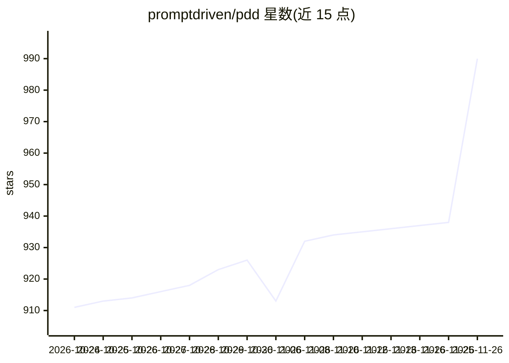

# promptdriven/pdd

⭐ 990 · JavaScript · MIT · 推送 2026-11-25 · [GitHub](https://github.com/promptdriven/pdd) · [官网](https://promptdriven.ai) · 组织维护

**以提示词为源码的开发工作流 CLI 与编码代理技能**

PDD 提供 `pdd` 命令与一个可安装到 Codex、Claude Code、Gemini CLI 等编码代理的 `/pdd` 技能，实现提示词与 Story 先行的开发流程：先编写提示词与用户故事，通过远程 Prompt Interpreter 运行提示词以提前验证行为，再由编码代理据批准的提示词生成代码并以 `pdd prove` 验证。工作流含 lint（0 AI 调用）、Story 测试、人工审批与 PR 环节；AI 调用设有预算上限，测试步骤限时 10 分钟。需 Node.js 22.16+、Git、GitHub CLI，支持 macOS 与 Linux。

## 筛选速览

| 维度 | 判定 | 备注 |
|---|---|---|
| AI 角色 | `ai-ecosystem` | LLM/agent 周边工具 |
| 许可风险 | `permissive` | MIT |
| 部署形态 | `library` | 以包/库形式分发 |
| 模型依赖 | — | README 未给出锁定关系 |
| 硬件要求 | — | 无带数字的原话,不猜 |
| 安装摩擦 | `low` | 无编译、无系统依赖或容器化 |
| 成熟度 | — | 结构信号不足 |

## 能力要点

- 提示词作为源文件：先审阅批准提示词，再由代理生成代码
- `pdd` 可直接运行提示词，支持浏览器界面、CLI 参数与 HTTP 服务三种形态
- 四类工作模式：product、bug、feature、small-change
- `pdd lint` 离线运行，0 AI 调用与 0 网络调用

## 适用场景

- 新功能开发前先以提示词验证预期行为
- 通过 Story 验收测试在写代码前确认需求
- 在聊天或 GitHub PR 中人工审阅提示词变更后开一个 PR

## 场景标签

`提示工程` `编码 Agent` · 领域:Agent 开发

## 证据(README 行号)

> L5: In PDD, you write prompts and Stories first. Prompts are the source of truth for your owned modules; Stories describ
> L16: PDD is the `pdd` command and one `/pdd` skill (`$pdd` in Codex, `/pdd` in Claude Code) with on-demand references fo

## 星数曲线

2026-10-24 911 → 2026-11-26 990（+79）

---
*卡片 v1 · prompt 1.4 · 生成 2026-11-26 · 置信度 mid · 依据 README sha `d52ff7dc6eb3` · [字段定义](../../DATASET.md)*
