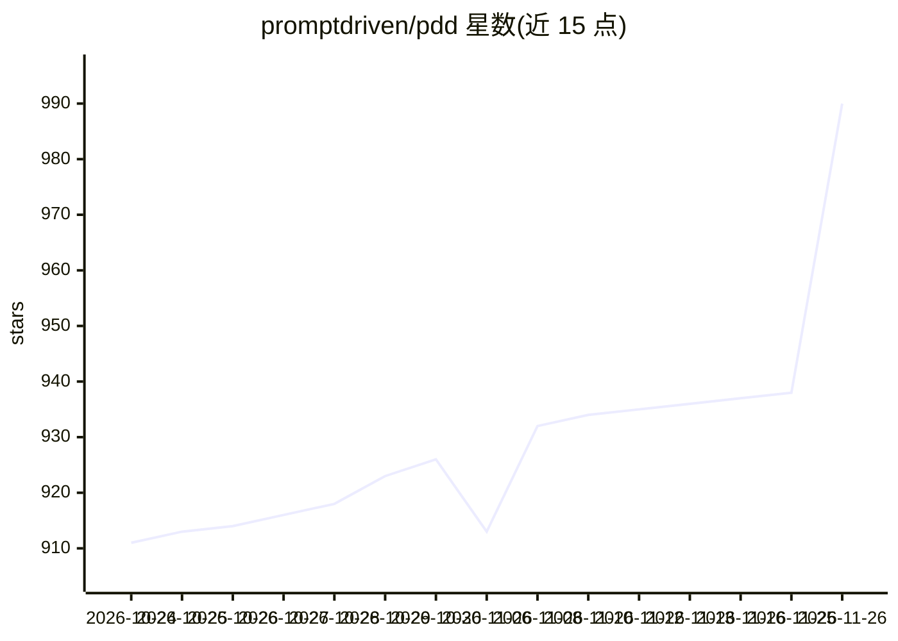

# promptdriven/pdd

⭐ 990 · JavaScript · MIT · 推送 2026-11-25 · [GitHub](https://github.com/promptdriven/pdd) · [官网](https://promptdriven.ai) · 组织维护

**给开发者用提示词驱动开发的 CLI 与编码代理技能**

PDD 提供 `pdd` 命令行与一个 `/pdd` 技能，把提示词文件作为源、代码作为生成产物：开发者先编写 prompt 与 Story，用 `pdd lint` 做零 AI 调用的离线结构检查、`pdd test` 在 PDD 解释器上运行场景测试、`pdd sim` 在写代码前通过浏览器/CLI/HTTP 模拟试用行为，再经 `pdd approve` 人工批准后由编码代理（Codex、Claude Code、Gemini CLI 等）实现代码并用 `pdd prove` 验证。需要 Node.js 22.16+、Git 与 GitHub CLI，仅在 macOS 与 Linux 上测试过。

## 筛选速览

| 维度 | 判定 | 备注 |
|---|---|---|
| AI 角色 | `ai-ecosystem` | LLM/agent 周边工具 |
| 许可风险 | `permissive` | MIT |
| 部署形态 | `library` | 以包/库形式分发 |
| 模型依赖 | — | README 未给出锁定关系 |
| 硬件要求 | — | 无带数字的原话,不猜 |
| 安装摩擦 | `low` | 无编译、无系统依赖或容器化 |
| 成熟度 | — | 结构信号不足 |

## 能力要点

- 提示词文件作为源，代码由编码代理从批准的 prompt 生成
- 写代码前可用 PDD Simulator 以 CLI/HTTP/浏览器方式试运行提示词行为
- pdd lint 离线运行，0 AI 调用、0 网络调用
- 审批流含人工批准门槛，Autopilot 可委托普通检查但严格审批仍需人工

## 适用场景

- 新功能开发前先定义 Story 验收标准并试用行为
- 以失败优先的测试复现缺陷并修复根因
- 多人协作中要求 prompt 变更经人工批准后才生成代码

## 场景标签

`提示工程` `代码生成` · 领域:Agent 开发

## 证据(README 行号)

> L5: In PDD, you write prompts and Stories first. Prompts are the source of truth for your owned modules; Stories describ
> L16: PDD is the `pdd` command and one `/pdd` skill (`$pdd` in Codex, `/pdd` in Claude Code) with on-demand references fo
> L20: You need Node.js 22.16.0 or newer (22.20.0+ for Autopilot), Git, and the GitHub CLI signed in with `gh auth login`.

## 星数曲线

2026-10-24 911 → 2026-11-26 990（+79）

---
*卡片 v1 · prompt 1.4 · 生成 2026-11-25 · 置信度 mid · 依据 README sha `fa7a00ead7a4` · [字段定义](../../DATASET.md)*
