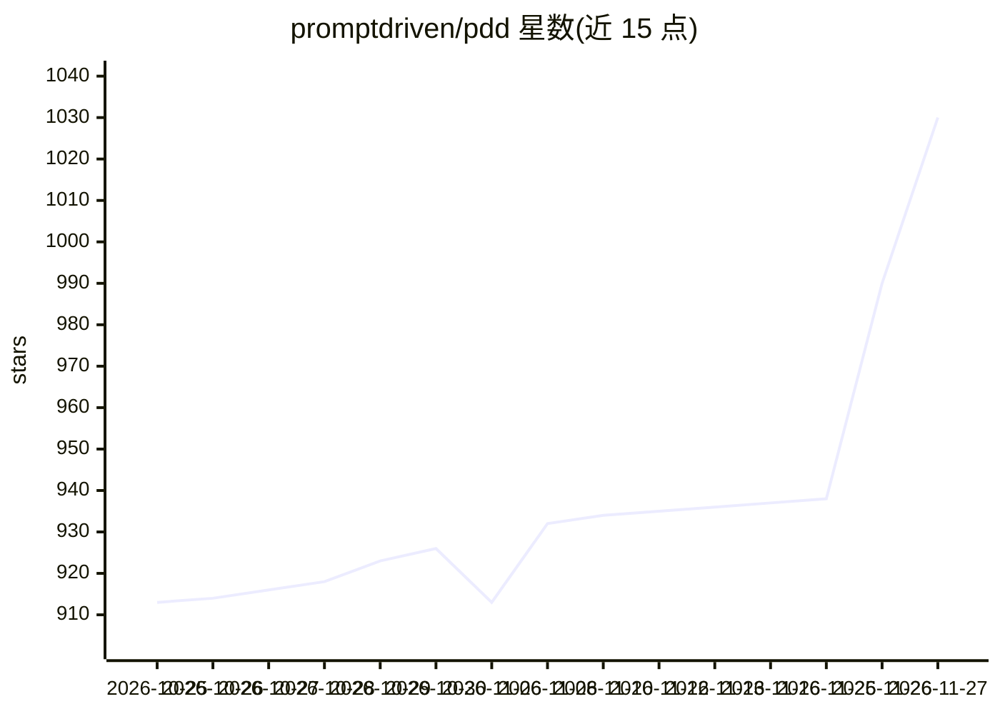

# promptdriven/pdd

⭐ 1,030 · JavaScript · MIT · 推送 2026-11-26 · [GitHub](https://github.com/promptdriven/pdd) · [官网](https://promptdriven.ai) · 组织维护

**为开发者提供的提示优先开发工作流 CLI 与编码代理技能**

PDD 提供一个 `pdd` 命令和 `/pdd` 代理技能：提示词文件与 Story 作为程序源，先在 Prompt Interpreter 上运行提示以在写代码前验证行为，再由编码代理依批准的提示生成代码并执行 `pdd prove`。工作流含 lint（离线、0 AI 调用）、Story 测试、聊天或 GitHub PR 人工审批，支持 Codex、Claude Code、Gemini CLI 等代理。依赖 Node.js 22.16.0+、Git、GitHub CLI；远程测试与直接运行需访问 PDD 解释器服务；仅在 macOS 与 Linux 上测试。

## 筛选速览

| 维度 | 判定 | 备注 |
|---|---|---|
| AI 角色 | `ai-ecosystem` | LLM/agent 周边工具 |
| 许可风险 | `permissive` | MIT |
| 部署形态 | `library` | 以包/库形式分发 |
| 模型依赖 | — | README 未给出锁定关系 |
| 硬件要求 | — | 无带数字的原话,不猜 |
| 安装摩擦 | `low` | 无编译、无系统依赖或容器化 |
| 成熟度 | — | 结构信号不足 |

## 能力要点

- 提示词与 Story 作为源文件，写代码前可在 Prompt Interpreter 直接运行验证
- 离线 `pdd lint` 执行结构/SVG/场景检查，0 AI 调用 0 网络调用
- AI 调用预算机制：新会话默认 400 次，步骤默认上限 12 次
- 支持 Autopilot 无头模式，人工必需审批仍保留

## 适用场景

- 在写实现代码前先以提示形式验证功能行为
- 以 Story 与验收标准驱动代理生成并验证代码
- 通过 GitHub PR 审批提示词变更而非直接审代码

## 场景标签

`提示工程` `编码 Agent` · 领域:Agent 开发

## 证据(README 行号)

> L5: In PDD, you write prompts and Stories first. Prompts are the source of truth for your owned modules; Stories describ
> L20: You need Node.js 22.16.0 or newer (22.20.0+ for Autopilot), Git, and the GitHub CLI signed in with `gh auth login`.

## 星数曲线

2026-10-25 913 → 2026-11-27 1,030（+117）

---
*卡片 v1 · prompt 1.4 · 生成 2026-11-27 · 置信度 mid · 依据 README sha `2862f51979ef` · [字段定义](../../DATASET.md)*
