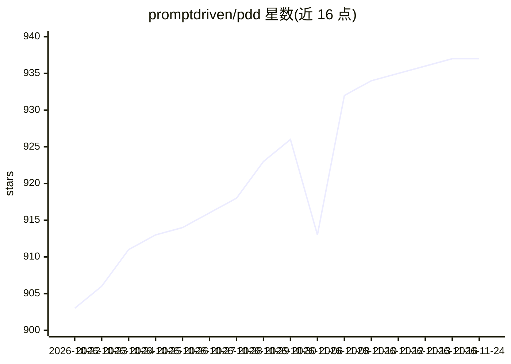

# promptdriven/pdd

⭐ 938 · JavaScript · MIT · 推送 2026-11-24 · [GitHub](https://github.com/promptdriven/pdd) · [官网](https://promptdriven.ai) · 组织维护

**以 Prompt 为源代码的开发方法与 CLI 工具链**

PDD 提供 `pdd` 命令行与一组 agent 技能：用户编写 Prompt 与 Story 作为程序源，PDD 解释器在代码生成前运行检查与模拟，随后由 agent 从 Prompt 生成代码。工作流包含 pdd lint/test/simulate/approve 等命令，配合 GitHub issue 标签驱动 Autopilot 自动开 PR、审查与合并（off/observe/auto 三种模式）。需要 Node.js 22.16.0+、Git、GitHub CLI 及任一 agent CLI，支持 macOS 与 Linux。

## 筛选速览

| 维度 | 判定 | 备注 |
|---|---|---|
| AI 角色 | `ai-ecosystem` | LLM/agent 周边工具 |
| 许可风险 | `permissive` | MIT |
| 部署形态 | `library` | 以包/库形式分发 |
| 模型依赖 | — | README 未给出锁定关系 |
| 硬件要求 | — | 无带数字的原话,不猜 |
| 安装摩擦 | `low` | 无编译、无系统依赖或容器化 |
| 成熟度 | — | 结构信号不足 |

## 能力要点

- Prompt 即源码：pdd 解释器在无代码阶段运行测试与模拟（CLI/HTTP API/浏览器界面）
- Autopilot 按 GitHub issue 标签在后台运行 agent 并开 PR，支持 observe/auto 模式
- 技能体系：pdd-feature/pdd-product/pdd-bug 等 6 类技能供 agent 调用
- pdd autopilot doctor 做环境自检，不做 GitHub 写入与 AI 调用

## 适用场景

- 让 agent 按 issue 自动完成功能开发并提交 PR
- 在写代码之前通过模拟验证程序行为与验收标准
- 以 Story 验收测试驱动 prompt 迭代与 bug 修复

## 场景标签

`提示工程` `代码生成` `编码 Agent` · 领域:Agent 开发

## 证据(README 行号)

> L5: In PDD, you write prompts and Stories. The prompts are the source of your program. The PDD interpreter runs the prom
> L16: PDD is the `pdd` command and a set of skills for your agent. Your agent writes the prompts, the Stories, the tests 

## 星数曲线

2026-10-22 903 → 2026-11-24 937（+34）

---
*卡片 v1 · prompt 1.4 · 生成 2026-11-24 · 置信度 high · 依据 README sha `0208e38cec5c` · [字段定义](../../DATASET.md)*
