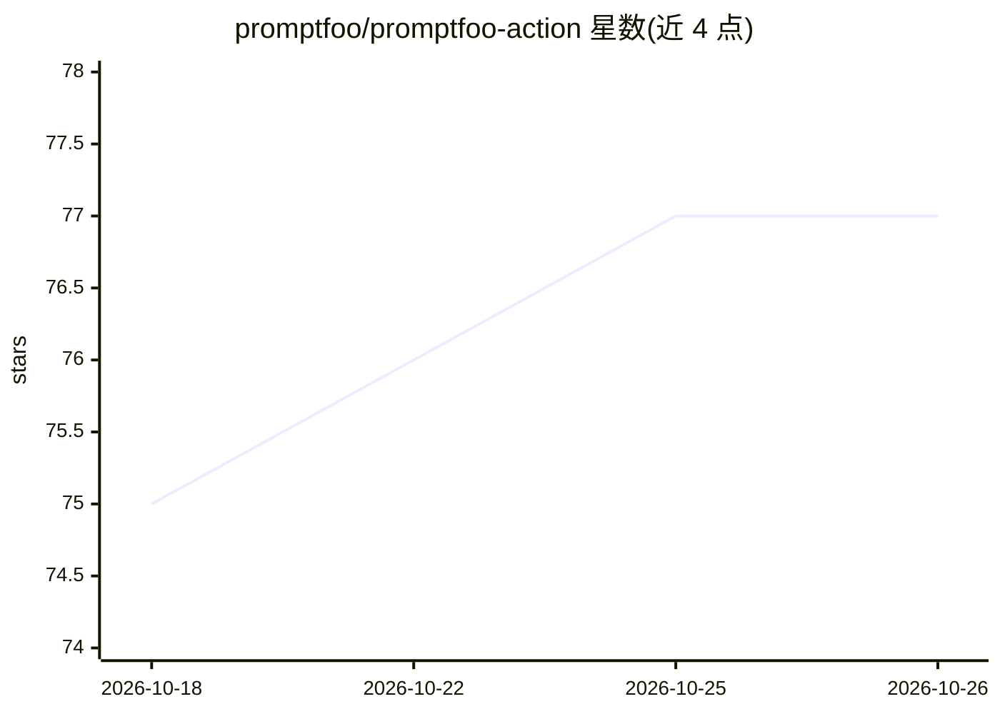

# promptfoo/promptfoo-action

⭐ 77 · TypeScript · MIT · 推送 2026-10-25 · [GitHub](https://github.com/promptfoo/promptfoo-action) · 组织维护

**在 GitHub Actions 中运行 Promptfoo 提示词评测的官方 Action**

Promptfoo 官方 GitHub Action：当受监控文件变更时触发 Promptfoo 评测，支持 pull_request、push、workflow_dispatch 三类事件，按变更文件匹配 prompts glob 选择性评测，并在 PR 评论或 workflow summary 中输出通过/失败计数，可选共享至 Promptfoo 网页查看器。提供 20+ 配置输入（通过率阈值、并发、repeat 重跑容忍 LLM 非确定性、磁盘缓存等）与多家模型厂商 API key 输入。面向希望在 CI/CD 中自动化 LLM 提示词评测的开发者。

## 筛选速览

| 维度 | 判定 | 备注 |
|---|---|---|
| AI 角色 | `ai-ecosystem` | LLM/agent 周边工具 |
| 许可风险 | `permissive` | MIT |
| 部署形态 | `library` | 以包/库形式分发 |
| 模型依赖 | — | README 未给出锁定关系 |
| 硬件要求 | — | 无带数字的原话,不猜 |
| 安装摩擦 | `low` | 无编译、无系统依赖或容器化 |
| 成熟度 | — | 结构信号不足 |

## 能力要点

- 支持 pull_request / push / workflow_dispatch 三类事件与变更文件过滤
- repeat + repeat-min-pass 机制容忍 LLM 评测的非确定性输出
- 支持 Promptfoo 磁盘缓存配置与 actions/cache 持久化，输出缓存统计
- 识别 Promptfoo 配置中的 file:// 自定义 provider 与通配符依赖以决定是否跳过评测

## 适用场景

- 在 PR 中自动评测变更的提示词并收到通过/失败评论
- 在 CI 中对提示词套件设置通过率阈值做门禁
- 对非确定性 LLM 评测用多次重跑降低抖动误报

## 场景标签

`提示工程` `模型评测` · 领域:Agent 开发

## 证据(README 行号)

> L3: This GitHub Action uses Promptfoo to evaluate
> L6: On pull requests, the action evaluates the current checkout and posts a summary
> L231: LLM eval outputs are non-deterministic. Use `repeat` to run each test multiple times and `repeat-min-pass` to requ

## 星数曲线

2026-10-18 75 → 2026-10-26 77（+2）

---
*卡片 v1 · prompt 1.4 · 生成 2026-10-24 · 置信度 mid · 依据 README sha `0990a34598db` · [字段定义](../../DATASET.md)*
