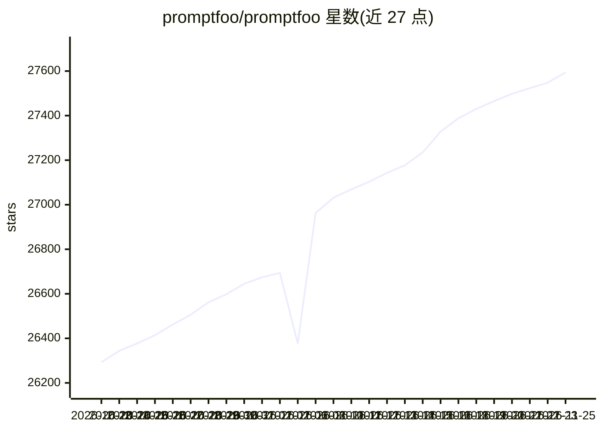

# promptfoo/promptfoo

⭐ 27,594 · TypeScript · MIT · 推送 2026-11-24 · [GitHub](https://github.com/promptfoo/promptfoo) · [官网](https://promptfoo.dev) · 组织维护

**面向开发者的 LLM 应用评测与红队扫描工具**

promptfoo 是一个 CLI 与库，用于对 LLM 应用（提示、agent、RAG）做自动化评测与红队测试。核心机制：声明式配置定义用例，命令行运行 eval，提供网页查看器对比模型输出，支持在 CI/CD 中自动化检查，并生成安全漏洞报告。评测在本地运行，无需上传提示内容。多数 LLM 提供商需配置 API key 环境变量。通过 npm/brew/pip 安装。

## 筛选速览

| 维度 | 判定 | 备注 |
|---|---|---|
| AI 角色 | `ai-ecosystem` | LLM/agent 周边工具 |
| 许可风险 | `permissive` | MIT |
| 部署形态 | `library` | 以包/库形式分发 |
| 模型依赖 | local-ok | 支持本地模型 |
| 硬件要求 | — | 无带数字的原话,不猜 |
| 安装摩擦 | `low` | 无编译、无系统依赖或容器化 |
| 成熟度 | — | 结构信号不足 |

## 动量与使用信号

- 维护:`active` — 距上次 push 0.9 天,年发版 78,386 位贡献者
- 涨星:近 1 天 **+45**(自 20261016 起算)
- 安装:npm 包 `promptfoo` 月下载 3,427,918
- 平台:— · 协议:OLLAMA

## 能力要点

- 声明式配置的 LLM 评测框架，CLI 运行与网页查看器对比结果
- 红队测试与漏洞扫描，生成安全报告
- CI/CD 集成与代码扫描审查 PR
- 评测 100% 本地运行，提示不离开本机

## 适用场景

- 上线前对提示词和模型做多组自动化评测
- 对 LLM 应用做红队测试与漏洞扫描
- 在 CI/CD 流水线中自动化检查 LLM 输出质量
- 并排对比多家模型供应商的表现

## 场景标签

`提示工程` `模型评测` `网络安全` · 领域:Agent 开发

## 证据(README 行号)

> L9:  <code>promptfoo</code> is a CLI and library for evaluating and red-teaming LLM-based apps. Stop using trial-and-err
> L47: - **Secure your LLM apps** with red teaming and vulnerability scanning

## 星数曲线

2026-10-23 26,293 → 2026-11-25 27,594（+1,301）

---
*卡片 v1 · prompt 1.4 · 生成 2026-11-22 · 置信度 high · 依据 README sha `247ca801b921` · [字段定义](../../DATASET.md)*
