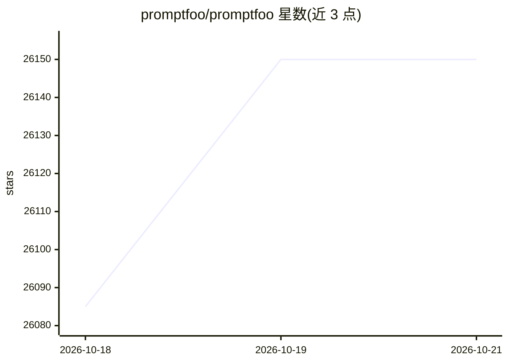

# promptfoo/promptfoo

⭐ 26,150 · TypeScript · MIT · 推送 2026-10-19 · [GitHub](https://github.com/promptfoo/promptfoo) · [官网](https://promptfoo.dev) · 组织维护

**为开发者提供 LLM 应用评估与红队扫描的 CLI/库**

promptfoo 是一个用于评估与红队测试 LLM 应用的 CLI 和库：支持对 prompt、agent 与 RAG 做自动化评估，进行漏洞扫描与红队测试，并排比较多个模型，在 CI/CD 中自动执行检查，通过代码扫描审查 PR 中的 LLM 安全与合规问题。评估可 100% 本地运行，配置采用声明式 YAML 式写法，附 Web 查看器展示评估矩阵与安全报告。安装途径覆盖 npm、brew、pip，也可用 npx 免安装运行。README 声明该项目现为 OpenAI 旗下，仍以 MIT 许可开源。

## 筛选速览

| 维度 | 判定 | 备注 |
|---|---|---|
| AI 角色 | `ai-ecosystem` | LLM/agent 周边工具 |
| 许可风险 | `permissive` | MIT |
| 部署形态 | `library` | 以包/库形式分发 |
| 模型依赖 | local-ok | 支持本地模型 |
| 硬件要求 | — | 无带数字的原话,不猜 |
| 安装摩擦 | `low` | 无编译、无系统依赖或容器化 |
| 成熟度 | — | 结构信号不足 |

## 动量与使用信号

- 维护:`active` — 距上次 push 0.9 天,年发版 78,386 位贡献者
- 涨星:近 1 天 **+45**(自 20261016 起算)
- 安装:npm 包 `promptfoo` 月下载 3,427,918
- 平台:— · 协议:OLLAMA

## 能力要点

- 自动化评估 prompt、agent 与 RAG 应用
- 红队测试与 LLM 漏洞扫描并生成安全报告
- 并排比较 OpenAI、Anthropic、Azure、Bedrock、Ollama 等模型
- CI/CD 集成与 PR 代码扫描审查

## 适用场景

- 发布前对 prompt 与 agent 做回归评估
- 对 LLM 应用做红队测试找出漏洞
- 在 CI/CD 流水线中自动执行 LLM 检查
- 团队共享评估结果并并排比较模型

## 场景标签

`模型评测` `网络安全` · 领域:评测与运维

## 证据(README 行号)

> L9:  <code>promptfoo</code> is a CLI and library for evaluating and red-teaming LLM-based apps. Stop using trial-and-err
> L46: - **Test your prompts and models** with automated evaluations
> L48: - **Compare models** side-by-side (OpenAI, Anthropic, Azure, Bedrock, Ollama, and more)

## 星数曲线

2026-10-18 26,085 → 2026-10-21 26,150（+65）

---
*卡片 v1 · prompt 1.4 · 生成 2026-10-18 · 置信度 high · 依据 README sha `0916e5a9f9d0` · [字段定义](../../DATASET.md)*
