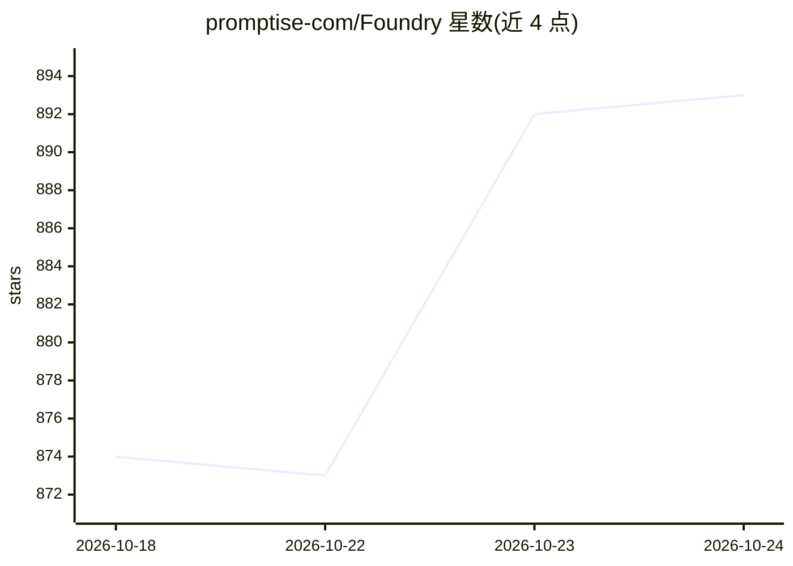

# promptise-com/Foundry

⭐ 892 · Python · Apache-2.0 · 推送 2026-10-24 · [GitHub](https://github.com/promptise-com/Foundry) · [官网](https://www.promptise.com/) · 组织维护

**构建、运行与治理 AI agent 的全栈 Python 框架**

Python 框架 Promptise Foundry，面向需要 agent 系统可问责的开发团队，覆盖三层：Agent（推理、记忆、RAG、guardrails）、Interface（MCP 服务端/客户端，MCPcast 可将 OpenAPI 规范生成 MCP 服务）、Harness（无人值守运行、预算、身份、审计与恢复）。通过统一模型字符串接入 OpenAI/Anthropic/Bedrock/Ollama 等多种模型，支持多租户隔离、服务端强制人工审批、防篡改审计链，安全模型与向量库可本地运行以支持离线部署。

## 筛选速览

| 维度 | 判定 | 备注 |
|---|---|---|
| AI 角色 | `ai-ecosystem` | LLM/agent 周边工具 |
| 许可风险 | `permissive` | Apache-2.0 |
| 部署形态 | `self-host` | docker 或自建部署 |
| 模型依赖 | local-ok | 支持本地模型 |
| 硬件要求 | — | 无带数字的原话,不猜 |
| 安装摩擦 | `low` | 无编译、无系统依赖或容器化 |
| 成熟度 | — | 结构信号不足 |

## 能力要点

- Agent/Interface/Harness 三层结构：推理、工具接入与运行治理一体化
- MCPcast 从 OpenAPI/Swagger 规范生成可安装的 MCP 服务项目，写入操作服务端审批门控
- 多租户数据隔离与服务端强制人工审批、防篡改审计链
- 支持 OpenAI/Anthropic/Azure/Bedrock/Ollama 等多模型，安全模型与向量库可离线运行

## 适用场景

- 在本地起步构建 agent，后续扩展为无人值守运行的多 agent 集群
- 将现有 REST API 转成带审批门控的 MCP 工具供 agent 调用
- 在合规或离线环境中部署带身份认证与审计的 agent 系统

## 场景标签

`Agent 框架` `多智能体` · 领域:Agent 开发

## 证据(README 行号)

> L20: Promptise gives you everything an agentic system needs, in one place and working together from the first line: agen
> L30: |**Harness** · *it operates*|Keeps your agents running around the clock, within budget, and accountable for everyth
> L162: Run agents unattended, on budget, recoverable.

## 星数曲线

2026-10-18 874 → 2026-10-24 893（+19）

---
*卡片 v1 · prompt 1.4 · 生成 2026-10-21 · 置信度 mid · 依据 README sha `ad8cc62aa701` · [字段定义](../../DATASET.md)*
