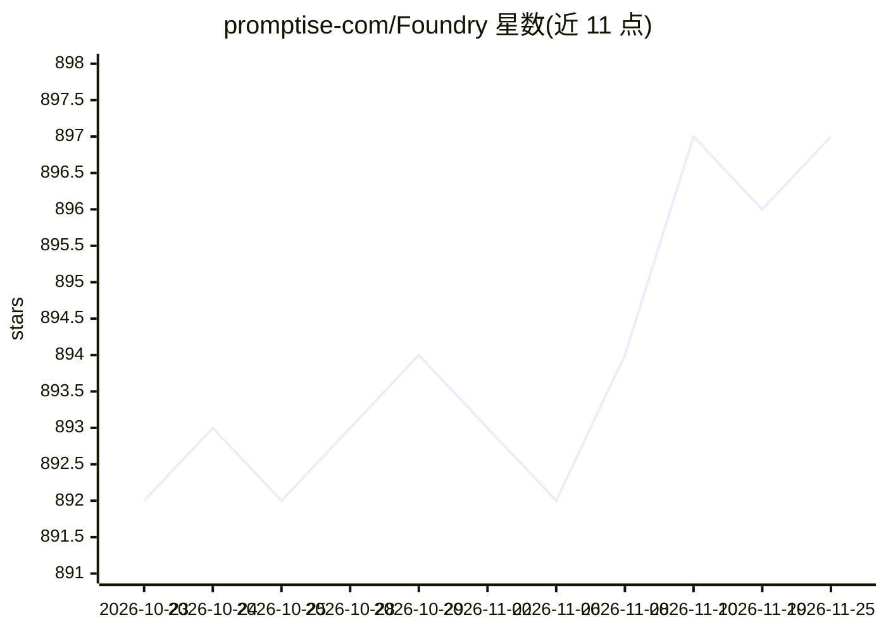

# promptise-com/Foundry

⭐ 897 · Python · Apache-2.0 · 推送 2026-11-08 · [GitHub](https://github.com/promptise-com/Foundry) · [官网](https://www.promptise.com/) · 组织维护

**为开发者提供构建与运行 agent 系统的一体化 Python 框架**

Promptise 是一个 Python agent 框架，按 Agent（推理）、Interface（通过 MCP 访问工具与数据）、Harness（运行时，含预算、触发器、审计与恢复）三层组织。@tool 装饰器将 Python 函数转为工具，可接入 MCP server；MCPcast 从 OpenAPI/Swagger 文档生成 MCP server 项目；内置多租户隔离、人工审批门、agent 身份认证与审计链，支持本地运行安全模型与嵌入以实现离线部署。通过 pip 安装，Python 3.10-3.13，Apache 2.0 许可。

## 筛选速览

| 维度 | 判定 | 备注 |
|---|---|---|
| AI 角色 | `ai-ecosystem` | LLM/agent 周边工具 |
| 许可风险 | `permissive` | Apache-2.0 |
| 部署形态 | `self-host` | docker 或自建部署 |
| 模型依赖 | local-ok | 支持本地模型 |
| 硬件要求 | — | 无带数字的原话,不猜 |
| 安装摩擦 | `low` | 无编译、无系统依赖或容器化 |
| 成熟度 | — | 结构信号不足 |

## 能力要点

- 模型以单一字符串指定（openai:/anthropic:/ollama: 等），同一字符串贯穿 build_agent、文件与 CLI
- MCPcast 从 OpenAPI/Swagger 生成可安装的 MCP server 项目并附带测试与 Dockerfile
- 多租户数据隔离、服务端强制人工审批、防篡改审计链为框架内置能力
- promptise run 支持 devtools 追踪、TUI、HTTP API 与生产模式

## 适用场景

- 从单个 agent 起步并扩展为无人值守运行的 agent 集群
- 将已有 OpenAPI 接口转为供 agent 调用的 MCP 工具集
- 在受监管或离线环境中本地运行整套 agent 栈
- 构建需要租户隔离与审批留痕的企业 agent 平台

## 场景标签

`Agent 框架` · 领域:Agent 开发

## 证据(README 行号)

> L18: **The framework for agentic intelligence.**
> L20: Promptise gives you everything an agentic system needs, in one place and working together from the first line: agen
> L63: `promptise.toml` is to an agent project what `package.json` is to a Node project: it names the `main` file, the scr

## 星数曲线

2026-10-23 892 → 2026-11-25 897（+5）

---
*卡片 v1 · prompt 1.4 · 生成 2026-11-24 · 置信度 mid · 依据 README sha `50f80220003d` · [字段定义](../../DATASET.md)*
