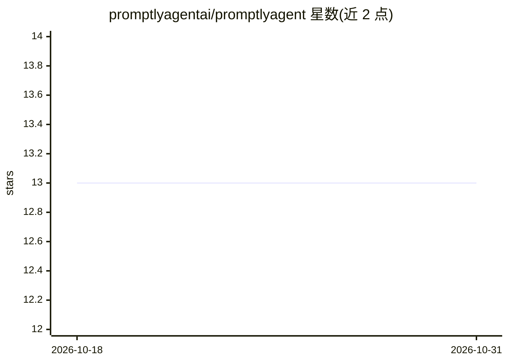

# promptlyagentai/promptlyagent

⭐ 13 · PHP · NOASSERTION · 推送 2026-06-27 · [GitHub](https://github.com/promptlyagentai/promptlyagent) · [官网](https://promptlyagent.ai) · 组织维护

**Laravel 多智能体编排与知识管理框架，含 RAG 与包扩展体系**

基于 Laravel/TALL 栈的 AI 应用开发框架：提供可配置多智能体系统（通过 Prism-PHP 接入 OpenAI、Anthropic、Google、AWS Bedrock）、工具生态与工作流编排；知识管理侧支持 Meilisearch 混合检索、RAG 管线、多源导入与隐私分级；自注册包系统可零核心改动扩展工具、知识源、触发器与输出动作，内置 Notion/Slack/Webhook/定时任务集成。全部通过 Docker（Laravel Sail）运行，需至少一个 AI 提供商 API key，管理员经 CLI 创建。

## 筛选速览

| 维度 | 判定 | 备注 |
|---|---|---|
| AI 角色 | `ai-ecosystem` | LLM/agent 周边工具 |
| 许可风险 | `none` | NOASSERTION |
| 部署形态 | `self-host` | docker 或自建部署 |
| 模型依赖 | locked-api |  |
| 硬件要求 | — | 无带数字的原话,不猜 |
| 安装摩擦 | `low` | 无编译、无系统依赖或容器化 |
| 成熟度 | — | 结构信号不足 |

## 能力要点

- Prism-PHP 多提供商接入（OpenAI/Anthropic/Google/Bedrock）
- Meilisearch 混合检索 + RAG 管线与隐私分级
- 零核心改动的自注册包扩展系统（工具/知识源/触发器/输出动作）
- 全 Docker（Laravel Sail）运行，无需本地 PHP/Node

## 适用场景

- 构建带自有知识库的 AI 研究型应用
- 编排多智能体完成复杂研究任务并接入 Notion/Slack
- 通过包系统扩展自定义 agent 工具与外部集成

## 场景标签

`多智能体` `Agent 框架` `RAG` `知识库管理` · 领域:Agent 开发

## 证据(README 行号)

> L5: PromptlyAgent is a Laravel-based framework that combines multi-agent AI orchestration with advanced knowledge manage
> L22: - **Multi-Provider Support**: Leverage OpenAI, Anthropic, Google, and AWS Bedrock through Prism-PHP

## 星数曲线

2026-10-18 13 → 2026-10-31 13（+0）

---
*卡片 v1 · prompt 1.4 · 生成 2026-10-31 · 置信度 high · 依据 README sha `0f3159da8226` · [字段定义](../../DATASET.md)*
