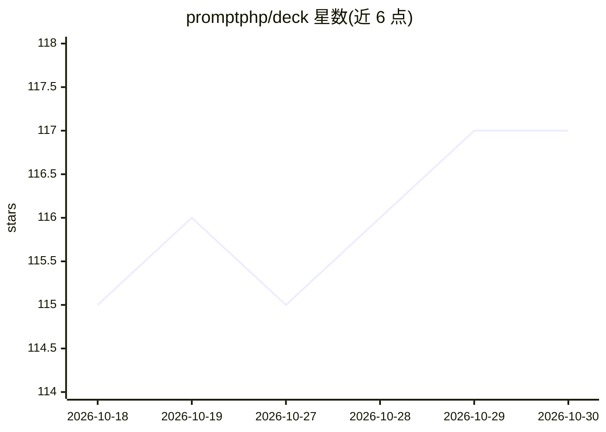

# promptphp/deck

⭐ 117 · PHP · MIT · 推送 2026-10-29 · [GitHub](https://github.com/promptphp/deck) · [官网](https://deck.promptphp.com/) · 个人维护

**Laravel/PHP 的 AI 提示词版本管理包：模板变量、A/B 测试**

Deck（原 Prompt Deck）是面向 Laravel/PHP 开发者的 AI 提示词管理 Composer 包：以版本化文件组织 agent 指令，通过 Artisan 命令创建/迭代版本，metadata.json 中 active_version 控制线上版本，可随时激活或回滚，新版本起草不影响生产。支持 {{ $variable }} 模板变量插值、prompt:list 查看、性能跟踪与 A/B 测试（README 标题描述声明），并提供 Laravel AI SDK 集成：HasPromptTemplate trait 自动为 agent 提供指令，make:agent 自动生成对应提示词目录。

## 筛选速览

| 维度 | 判定 | 备注 |
|---|---|---|
| AI 角色 | `ai-ecosystem` | LLM/agent 周边工具 |
| 许可风险 | `permissive` | MIT |
| 部署形态 | `None` |  |
| 模型依赖 | — | README 未给出锁定关系 |
| 硬件要求 | — | 无带数字的原话,不猜 |
| 安装摩擦 | `low` | 无编译、无系统依赖或容器化 |
| 成熟度 | — | 结构信号不足 |

## 能力要点

- 版本化提示词文件，active_version 控制线上版本，可回滚
- Blade 风格 {{ $variable }} 变量插值渲染
- Artisan 命令 make:prompt / prompt:activate / prompt:list 管理全流程
- HasPromptTemplate trait 与 Laravel AI SDK 集成，make:agent 自动生成提示词目录

## 适用场景

- 在 Laravel 应用中以文件形式管理和迭代 AI agent 指令
- 生产环境起草新提示词版本、验证后再激活上线
- A/B 测试比较不同提示词版本的输出表现

## 场景标签

`提示工程` · 领域:Agent 开发

## 证据(README 行号)

> L11: Deck, formerly Prompt Deck, provides AI prompt management for Laravel and PHP.
> L13: Organise your AI agent instructions as versioned files, compare prompt performance, and activate the right version 

## 星数曲线

2026-10-18 115 → 2026-10-30 117（+2）

---
*卡片 v1 · prompt 1.4 · 生成 2026-10-23 · 置信度 high · 依据 README sha `21696ea57b85` · [字段定义](../../DATASET.md)*
