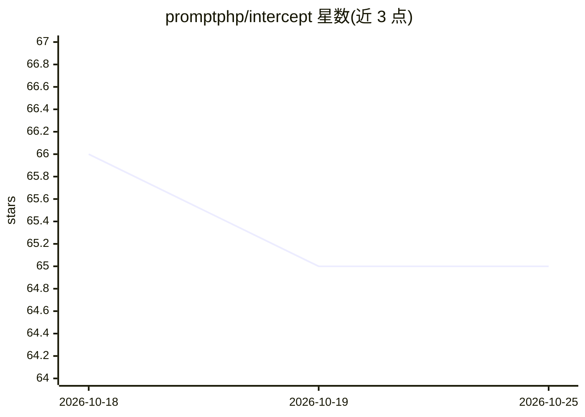

# promptphp/intercept

⭐ 65 · PHP · MIT · 推送 2026-10-21 · [GitHub](https://github.com/promptphp/intercept) · [官网](https://intercept.promptphp.com/) · 组织维护

**Laravel AI SDK 代理的可复用中间件集合**

面向 Laravel AI SDK 的模块化即插即用中间件集合，覆盖安全、可观测性、性能与引导四类。工作方式是置于 AI 代理与 AI 提供方之间，在提示词到达提供方前施加护栏，类似 HTTP 中间件位于路由与业务逻辑之间的关系。要求 PHP 8.3+ 与 laravel/ai ^1.0，文档独立站点维护，含路线图与变更日志。MIT 许可。

## 筛选速览

| 维度 | 判定 | 备注 |
|---|---|---|
| AI 角色 | `ai-ecosystem` | LLM/agent 周边工具 |
| 许可风险 | `permissive` | MIT |
| 部署形态 | `None` |  |
| 模型依赖 | — | README 未给出锁定关系 |
| 硬件要求 | — | 无带数字的原话,不猜 |
| 安装摩擦 | `low` | 无编译、无系统依赖或容器化 |
| 成熟度 | — | 结构信号不足 |

## 能力要点

- 安全/可观测/性能/引导四类中间件
- 置于代理与提供方之间的提示词护栏机制
- 即插即用、模块化设计

## 适用场景

- 为 Laravel AI SDK 代理添加 PII 检测与脱敏
- 拦截提示注入等安全风险
- 为代理调用添加可观测性

## 场景标签

`LLM 可观测性` `网络安全` · 领域:评测与运维

## 证据(README 行号)

> L12: Intercept is a modular, drop-in collection of reusable AI agent middleware for the Laravel AI SDK offering middlewa
> L23: > Requires PHP 8.3+ and `laravel/ai` ^1.0.

## 星数曲线

2026-10-18 66 → 2026-10-25 65（-1）

---
*卡片 v1 · prompt 1.4 · 生成 2026-10-24 · 置信度 high · 依据 README sha `47b67468dfa0` · [字段定义](../../DATASET.md)*
