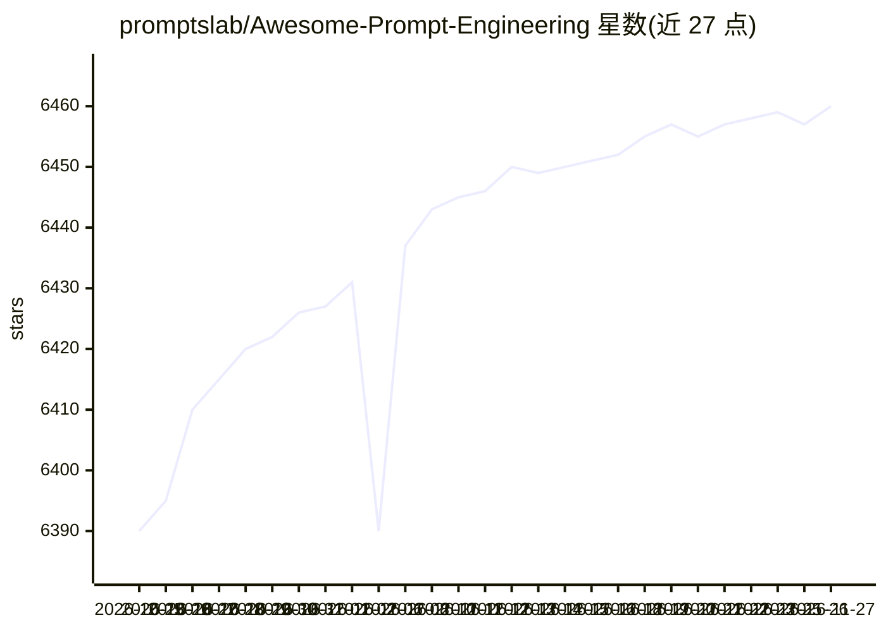

# promptslab/Awesome-Prompt-Engineering

⭐ 6,460 · TypeScript · Apache-2.0 · 推送 2026-11-26 · [GitHub](https://github.com/promptslab/Awesome-Prompt-Engineering) · [官网](https://discord.gg/m88xfYMbK6) · 组织维护

**面向学习者的提示工程论文与资源精选清单**

手工整理的提示工程（Prompt Engineering）与上下文工程资源合集，收录综述、提示优化、思维链、上下文学习、多智能体、提示注入安全、多模态及文生图/音乐等方向的论文条目，并为新手提供从入门课程、指南到厂商文档的学习路径。目标读者为研究和使用大语言模型提示技术的学习者与开发者。README 主体为论文列表，工具、API、基准等目录条目在后续章节。

## 筛选速览

| 维度 | 判定 | 备注 |
|---|---|---|
| AI 角色 | `ai-knowledge` | 知识聚合/清单类 |
| 许可风险 | `permissive` | Apache-2.0 |
| 部署形态 | `library` | 以包/库形式分发 |
| 模型依赖 | — | README 未给出锁定关系 |
| 硬件要求 | — | 无带数字的原话,不猜 |
| 安装摩擦 | `medium` | 含编译或系统依赖之一 |
| 成熟度 | — | 结构信号不足 |

## 能力要点

- 按 11 个主题分类的提示工程论文集（含 2020-2025 文献）
- 为新手提供五步学习路径（课程→指南→厂商文档→研究）
- 覆盖提示优化、压缩、CoT 推理、注入安全等前沿方向
- 条目附年份、发表会议与一句话内容概述

## 适用场景

- 系统学习提示工程的基础概念与最新研究
- 查找思维链、提示优化等特定方向的论文
- 了解提示注入攻防与 LLM 安全研究进展

## 场景标签

`提示工程` `精选清单` · 领域:Agent 开发

## 证据(README 行号)

> L3:  A hand-curated collection of resources for Prompt Engineering and Context Engineering — covering papers, tools, mod
> L28: ## Papers
> L18: New to prompt engineering? Follow this path:

## 星数曲线

2026-10-25 6,390 → 2026-11-27 6,460（+70）

---
*卡片 v1 · prompt 1.4 · 生成 2026-11-27 · 置信度 mid · 依据 README sha `01b927ae8a67` · [字段定义](../../DATASET.md)*
