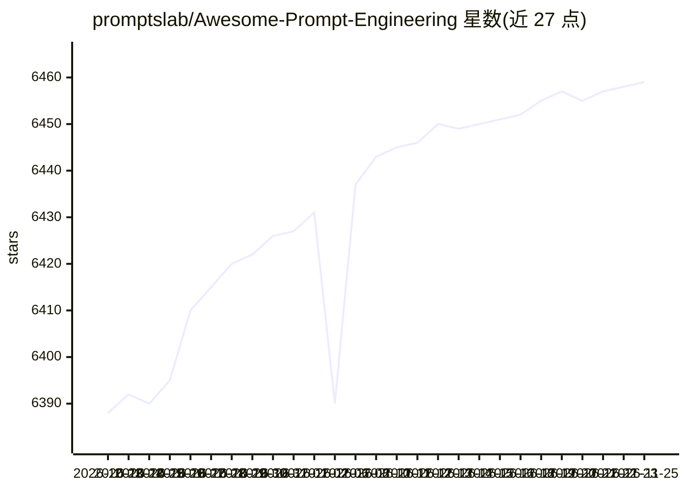

# promptslab/Awesome-Prompt-Engineering

⭐ 6,459 · TypeScript · Apache-2.0 · 推送 2026-11-23 · [GitHub](https://github.com/promptslab/Awesome-Prompt-Engineering) · [官网](https://discord.gg/m88xfYMbK6) · 个人维护

**提示工程（Prompt Engineering）资源的策展清单**

以链接清单形式组织的提示工程资源合集，覆盖论文、工具、模型、API、基准、课程与社区等内容板块。论文部分按综述、提示优化与自动提示、提示压缩、推理进展、上下文学习、智能体提示、多模态提示、结构化输出、提示注入安全、文本生成图像/音频等主题分类，收录 2020 至 2025 年的论文条目并附一句话说明。面向学习提示工程的开发者与研究者，并提供入门学习路径与配套课程站点。

## 筛选速览

| 维度 | 判定 | 备注 |
|---|---|---|
| AI 角色 | `ai-knowledge` | 知识聚合/清单类 |
| 许可风险 | `permissive` | Apache-2.0 |
| 部署形态 | `library` | 以包/库形式分发 |
| 模型依赖 | — | README 未给出锁定关系 |
| 硬件要求 | — | 无带数字的原话,不猜 |
| 安装摩擦 | `medium` | 含编译或系统依赖之一 |
| 成熟度 | — | 结构信号不足 |

## 能力要点

- 按 10+ 主题分类的提示工程论文清单（综述/优化/压缩/推理/安全等）
- 提供新手入门学习路径（课程、指南、厂商文档）
- 覆盖提示注入与安全基准专题条目
- 附配套课程网站 promptslab.github.io

## 适用场景

- 系统学习提示工程的基础概念与技术分类
- 查找提示优化、提示压缩等方向的论文入口
- 了解提示注入攻防与智能体安全基准的研究进展
- 检索文本生成图像/音频提示方法的相关文献

## 场景标签

`提示工程` `精选清单` · 领域:Agent 开发

## 证据(README 行号)

> L3:  A hand-curated collection of resources for Prompt Engineering and Context Engineering — covering papers, tools, mod
> L28: ## Papers

## 星数曲线

2026-10-23 6,388 → 2026-11-25 6,459（+71）

---
*卡片 v1 · prompt 1.4 · 生成 2026-11-24 · 置信度 mid · 依据 README sha `842e8c150c68` · [字段定义](../../DATASET.md)*
