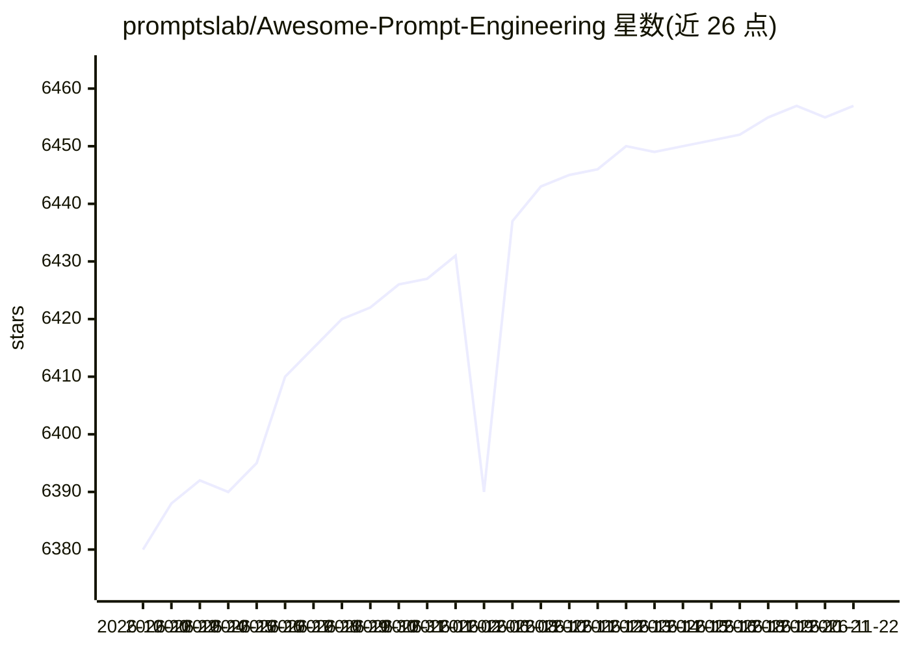

# promptslab/Awesome-Prompt-Engineering

⭐ 6,457 · TypeScript · Apache-2.0 · 推送 2026-11-21 · [GitHub](https://github.com/promptslab/Awesome-Prompt-Engineering) · [官网](https://discord.gg/m88xfYMbK6) · 组织维护 · 中文 README

**提示工程资源策展清单：为 LLM 使用者汇集论文/工具/课程**

手工策展的 Prompt Engineering 与 Context Engineering 资源聚合清单，按论文（综述、提示优化、压缩、推理、上下文学习、Agent 提示、多模态、结构化输出、注入安全、应用、文生图/音频）等主题分类组织，收录带年份与会议信息的条目，并为初学者提供学习路径。仓库另配套网站与课程入口，通过 PR 持续更新；可见部分以论文条目为主，无运行代码与安装步骤。

## 筛选速览

| 维度 | 判定 | 备注 |
|---|---|---|
| AI 角色 | `ai-knowledge` | 知识聚合/清单类 |
| 许可风险 | `permissive` | Apache-2.0 |
| 部署形态 | `library` | 以包/库形式分发 |
| 模型依赖 | — | README 未给出锁定关系 |
| 硬件要求 | — | 无带数字的原话,不猜 |
| 安装摩擦 | `medium` | 含编译或系统依赖之一 |
| 成熟度 | — | 结构信号不足 |

## 能力要点

- 按 10+ 主题分类的提示工程论文清单，含 ACL/NeurIPS/USENIX 等出处
- 入门学习路径：从免费课程到 DAIR.AI 指南、官方文档与综述
- 覆盖提示注入攻防、Agent 提示、多模态提示等前沿子方向

## 适用场景

- 系统学习提示工程并按主题查找原始论文
- 为研究选题调研提示优化与推理方向的综述
- 为团队培训挑选提示工程课程与指南

## 场景标签

`提示工程` `精选清单` `教程课程` · 领域:Agent 开发

## 证据(README 行号)

> L3:  A hand-curated collection of resources for Prompt Engineering and Context Engineering — covering papers, tools, mod
> L28: ## Papers

## 星数曲线

2026-10-20 6,380 → 2026-11-22 6,457（+77）

---
*卡片 v1 · prompt 1.4 · 生成 2026-11-22 · 置信度 mid · 依据 README sha `7336cf71a222` · [字段定义](../../DATASET.md)*
