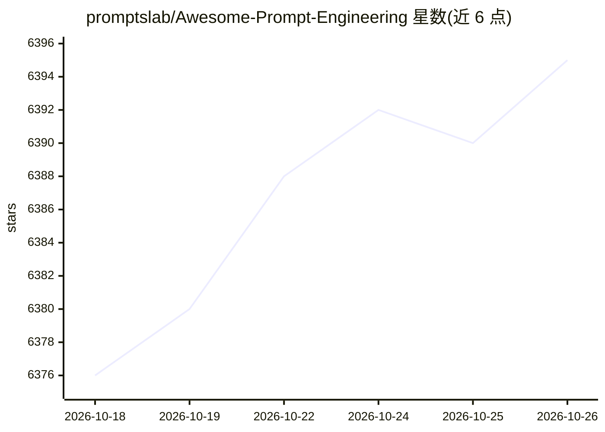

# promptslab/Awesome-Prompt-Engineering

⭐ 6,395 · TypeScript · Apache-2.0 · 推送 2026-10-25 · [GitHub](https://github.com/promptslab/Awesome-Prompt-Engineering) · [官网](https://discord.gg/m88xfYMbK6) · 组织维护

**提示工程与上下文工程资源清单：论文、工具、课程策展**

promptslab 维护的手工策展资源集合，覆盖提示工程与上下文工程领域：按主题组织论文（综述、提示优化、提示压缩、推理、上下文学习、多智能体、多模态提示、提示注入安全、文生图/音乐等）、工具、API、基准、课程与社区。入口给出新人学习路径（ChatGPT 提示工程课程、DAIR.AI 指南、OpenAI/Anthropic 官方文档）。以 GitHub README 与配套网页形式提供，条目含年份、发表会议与一句话说明。

## 筛选速览

| 维度 | 判定 | 备注 |
|---|---|---|
| AI 角色 | `ai-knowledge` | 知识聚合/清单类 |
| 许可风险 | `permissive` | Apache-2.0 |
| 部署形态 | `library` | 以包/库形式分发 |
| 模型依赖 | — | README 未给出锁定关系 |
| 硬件要求 | — | 无带数字的原话,不猜 |
| 安装摩擦 | `medium` | 含编译或系统依赖之一 |
| 成熟度 | — | 结构信号不足 |

## 能力要点

- 按十余个主题组织的论文清单（含 2024-2025 前沿工作）
- 新人入门学习路径（课程、指南、官方文档）
- 配套网站 promptslab.github.io
- 覆盖提示优化、压缩、安全（提示注入）、多模态等方向

## 适用场景

- 系统查找提示工程某一方向（如提示压缩、注入防御）的代表论文
- 按学习路径入门提示工程
- 跟踪推理模型时代的提示技术研究进展

## 场景标签

`精选清单` `提示工程` · 领域:Agent 开发

## 证据(README 行号)

> L3:  A hand-curated collection of resources for Prompt Engineering and Context Engineering — covering papers, tools, mod
> L28: ## Papers

## 星数曲线

2026-10-18 6,376 → 2026-10-26 6,395（+19）

---
*卡片 v1 · prompt 1.4 · 生成 2026-10-20 · 置信度 mid · 依据 README sha `fab12135aabb` · [字段定义](../../DATASET.md)*
