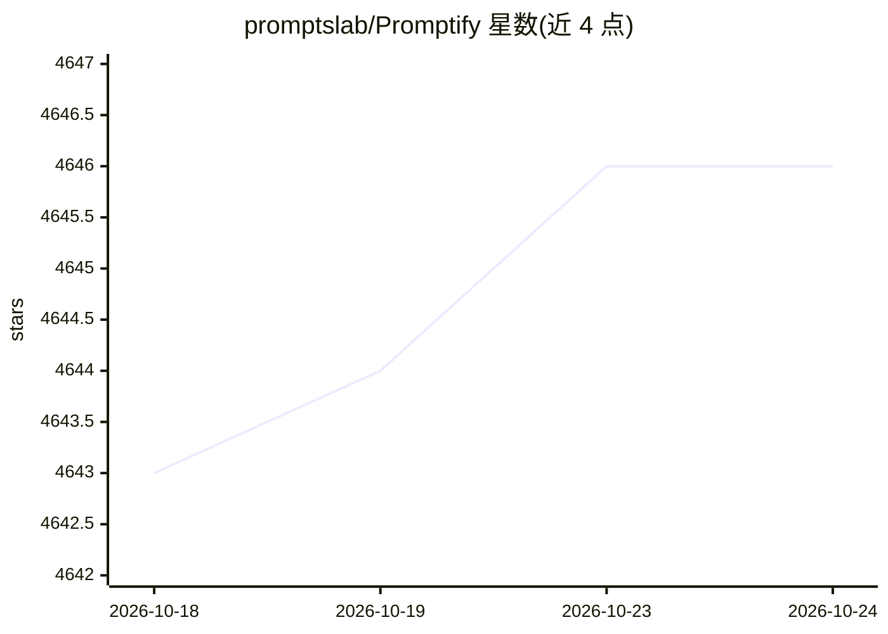

# promptslab/Promptify

⭐ 4,646 · Python · Apache-2.0 · 推送 2026-03-27 · [GitHub](https://github.com/promptslab/Promptify) · [官网](https://discord.gg/m88xfYMbK6) · 组织维护

**任务化 NLP 引擎：几行代码用 LLM 得到结构化输出**

面向开发者的 Python NLP 库，自称“LLM 版 scikit-learn”：提供 NER、分类、问答、摘要、关系抽取、SQL 生成等内置任务类，通过 Pydantic schema 输出类型安全的结构化结果，无需训练数据。经由 LiteLLM 作为统一后端，切换模型字符串即可访问 OpenAI、Anthropic、Ollama 等 100+ 提供方，含本地模型。另带评测框架（precision/recall/F1 等）、批量与异步处理、成本追踪和安全 JSON 解析回退。pip 安装，要求 Python 3.9+。

## 筛选速览

| 维度 | 判定 | 备注 |
|---|---|---|
| AI 角色 | `ai-ecosystem` | LLM/agent 周边工具 |
| 许可风险 | `permissive` | Apache-2.0 |
| 部署形态 | `library` | 以包/库形式分发 |
| 模型依赖 | local-ok | 支持本地模型 |
| 硬件要求 | — | 无带数字的原话,不猜 |
| 安装摩擦 | `low` | 无编译、无系统依赖或容器化 |
| 成熟度 | — | 结构信号不足 |

## 能力要点

- 内置 12+ NLP 任务类，2-3 行代码调用，无训练数据要求
- Pydantic 结构化输出，支持自定义 schema
- LiteLLM 统一后端接入 OpenAI/Anthropic/Ollama 等 100+ 提供方
- 内置评测框架与 token 成本追踪

## 适用场景

- 用 LLM 快速做命名实体识别、分类、问答等 NLP 任务
- 切换不同 LLM 提供方或本地模型而不改业务代码
- 对 LLM NLP 任务结果做 precision/recall/F1 评测

## 场景标签

`提示工程` `模型网关` `模型评测` · 领域:Agent 开发

## 证据(README 行号)

> L3:  Task-based NLP engine with Pydantic structured outputs, built-in evaluation, and LiteLLM as the universal LLM backe
> L123: - **Any LLM provider** via LiteLLM -OpenAI, Anthropic, Google, Ollama, Azure, and 100+ more

## 星数曲线

2026-10-18 4,643 → 2026-10-24 4,646（+3）

---
*卡片 v1 · prompt 1.4 · 生成 2026-10-20 · 置信度 high · 依据 README sha `f114c719aa32` · [字段定义](../../DATASET.md)*
