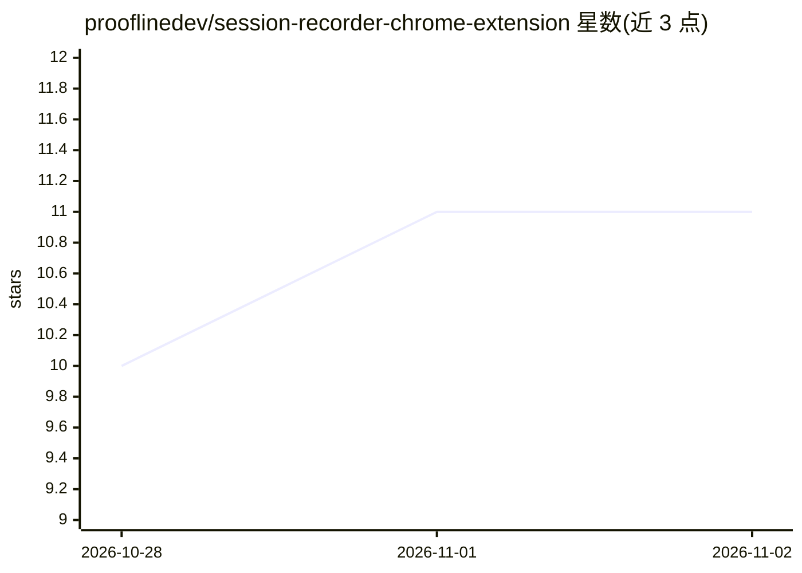

# prooflinedev/session-recorder-chrome-extension

⭐ 11 · TypeScript · AGPL-3.0 · 推送 2026-10-30 · [GitHub](https://github.com/prooflinedev/session-recorder-chrome-extension) · [官网](https://proofline.sh/session-recorder-chrome-extension/) · 组织维护

**开源 Chrome 扩展：录制浏览器 bug 会话并生成 GitHub issue**

面向 QA 与产品团队的免费开源 Chrome 扩展：录制浏览器操作、控制台/网络数据、截图、标注与语音叙述，生成含证据的完整报告，一键创建 GitHub issue。AI 功能可选：由用户自选 OpenAI/Anthropic/Google 或兼容端点生成摘要与标题，Deepgram/ElevenLabs 做语音转录；报告可导出 ZIP 供 Claude Code、Cursor 等编程 agent 使用。录制与标注无需账号或 API key；AGPL-3.0 许可。

## 筛选速览

| 维度 | 判定 | 备注 |
|---|---|---|
| AI 角色 | `ai-enhanced` | 去掉 AI 部分产品仍成立 |
| 许可风险 | `viral` | AGPL-3.0 |
| 部署形态 | `None` |  |
| 模型依赖 | — | README 未给出锁定关系 |
| 硬件要求 | — | 无带数字的原话,不猜 |
| 安装摩擦 | `low` | 无编译、无系统依赖或容器化 |
| 成熟度 | — | 结构信号不足 |

## 能力要点

- 录制点击、控制台、网络请求、截图与标注并生成报告
- 一键创建带证据的 GitHub issue
- 导出的 report.md 可直接交给编程 agent 使用
- 支持自选 AI 服务商或完全不使用 AI

## 适用场景

- 复现 bug 时录制完整证据并直接提 GitHub issue
- 把带截图与网络细节的报告交给编程 agent 定位问题
- QA 团队用标注和语音叙述补充 bug 现场

## 场景标签

 · 领域:开发者工具/QA

## 证据(README 行号)

> L5: Session Recorder is a **free, open-source Chrome extension** for QA and product teams. It captures browser activity 
> L17: Recording, annotation and ZIP export work without an account or API key. Configure publishing and GitHub access onc

## 星数曲线

2026-10-28 10 → 2026-11-02 11（+1）

---
*卡片 v1 · prompt 1.4 · 生成 2026-11-01 · 置信度 high · 依据 README sha `6477fca7088c` · [字段定义](../../DATASET.md)*
