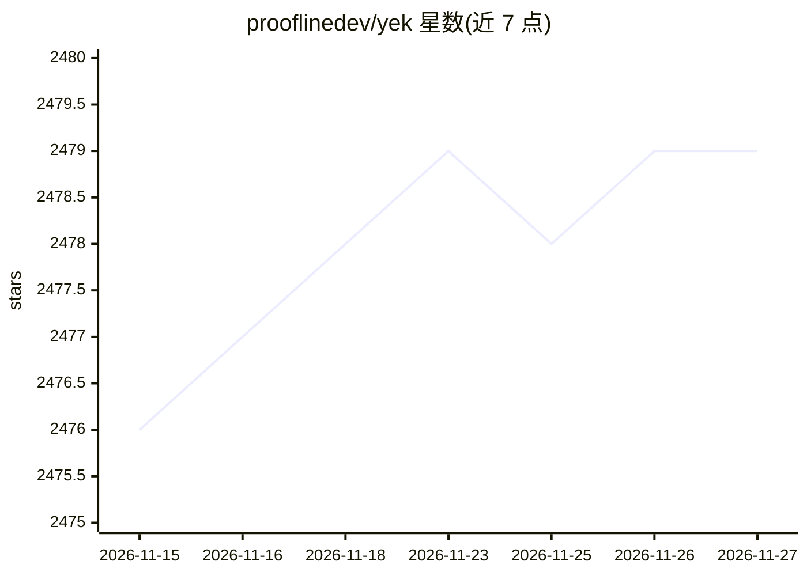

# prooflinedev/yek

⭐ 2,479 · Rust · MIT · 推送 2026-11-24 · [GitHub](https://github.com/prooflinedev/yek) · 组织维护

**把仓库文本文件序列化为单文件供 LLM 使用的 CLI 工具**

Rust 编写的命令行工具，将目录或仓库中的文本文件合并序列化为单一输出，供 LLM 消费：默认遵循 .gitignore 规则、依据 Git 历史推断文件重要性并把更重要的文件排在输出后部、自动跳过二进制与大文件。支持管道流式输出、多目录与 glob 选择、按字节或 token 上限裁剪、行号与目录树输出，可通过 yek.yaml/toml/json 配置优先级规则。由 Proofline 维护，MIT 许可。

## 筛选速览

| 维度 | 判定 | 备注 |
|---|---|---|
| AI 角色 | `ai-ecosystem` | LLM/agent 周边工具 |
| 许可风险 | `permissive` | MIT |
| 部署形态 | `desktop` | 安装包/桌面程序 |
| 模型依赖 | — | README 未给出锁定关系 |
| 硬件要求 | — | 无带数字的原话,不猜 |
| 安装摩擦 | `low` | 无编译、无系统依赖或容器化 |
| 成熟度 | — | 结构信号不足 |

## 能力要点

- 依据 Git 历史推断文件优先级，重要文件排后以利 LLM 注意力
- 支持 .gitignore、glob、多目录与按 token/字节上限裁剪
- yek.yaml/toml/json 配置优先级规则、忽略模式与输出模板
- Rust 实现并行处理，README 附与 Repomix 的序列化耗时对比

## 适用场景

- 把整个代码库打包成单文件喂给 LLM 做分析或改写
- 控制输出规模以适配模型的上下文窗口
- 配合剪贴板管道快速复制仓库内容到对话界面

## 场景标签

`文档解析` · 领域:知识与检索

## 证据(README 行号)

> L3: A fast Rust based tool to serialize text-based files in a repository or directory for LLM consumption.[^1]
> L38: > `yek` will prioritize more important files to come last in the output. This is useful for LLM consumption since L
> L221: `yek` is fast. It's written in Rust and does many things in parallel to speed up processing.

## 星数曲线

2026-11-15 2,476 → 2026-11-27 2,479（+3）

---
*卡片 v1 · prompt 1.4 · 生成 2026-11-17 · 置信度 high · 依据 README sha `a598da4596ed` · [字段定义](../../DATASET.md)*
