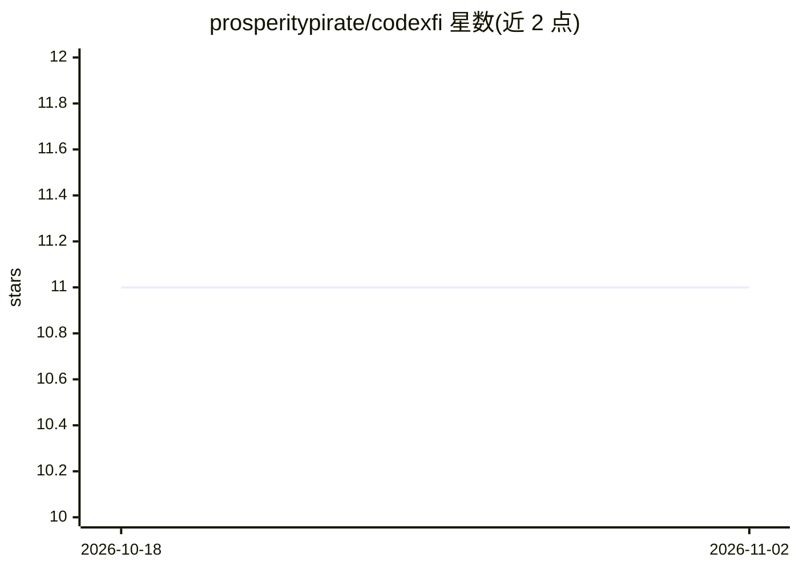

# prosperitypirate/codexfi

⭐ 11 · TypeScript · MIT · 推送 2026-09-28 · [GitHub](https://github.com/prosperitypirate/codexfi) · [官网](https://codexfi.com) · 个人维护

**为 OpenCode AI 编程代理提供跨会话持久记忆的插件**

面向 OpenCode AI coding agent 的 Bun 插件：每轮对话后自动抽取带类型的事实（架构、错误解决方案、偏好、进度等），存入本地嵌入式向量存储；每次 LLM 调用时将相关记忆注入系统提示词的 [MEMORY] 块，实现跨会话记忆。抽取支持 Anthropic/xAI/Google 三家 API，嵌入使用 Voyage voyage-code-3，含去重与矛盾处理。数据留在本机 ~/.codexfi/，仅向嵌入与抽取 API 外发请求；提供 CLI 与 Web 仪表盘。依赖 Bun 运行时与 OpenCode。

## 筛选速览

| 维度 | 判定 | 备注 |
|---|---|---|
| AI 角色 | `ai-ecosystem` | LLM/agent 周边工具 |
| 许可风险 | `permissive` | MIT |
| 部署形态 | `None` |  |
| 模型依赖 | locked-api |  |
| 硬件要求 | — | 无带数字的原话,不猜 |
| 安装摩擦 | `low` | 无编译、无系统依赖或容器化 |
| 成熟度 | — | 结构信号不足 |

## 能力要点

- 每轮自动抽取并本地存储类型化记忆，跨会话注入上下文
- 多抽取提供商（Anthropic Haiku 默认 / xAI / Google）+ Voyage voyage-code-3 嵌入
- 纯 TypeScript 本地向量存储，数据留在 ~/.codexfi/
- CLI（list/search/stats/export/forget）与 Web 仪表盘

## 适用场景

- 让 OpenCode 代理记住项目决策、错误修复与我的偏好
- 避免每个会话重复交代上下文
- 通过仪表盘查看与导出代理记忆

## 场景标签

`Agent 记忆` · 领域:Agent 开发

## 证据(README 行号)

> L23: **codexfi fixes this.** After every assistant turn, key facts are automatically extracted and stored locally. On ev
> L3: **Persistent memory for OpenCode AI agents.**

## 星数曲线

2026-10-18 11 → 2026-11-02 11（+0）

---
*卡片 v1 · prompt 1.4 · 生成 2026-11-01 · 置信度 high · 依据 README sha `a6c16e9f3af1` · [字段定义](../../DATASET.md)*
