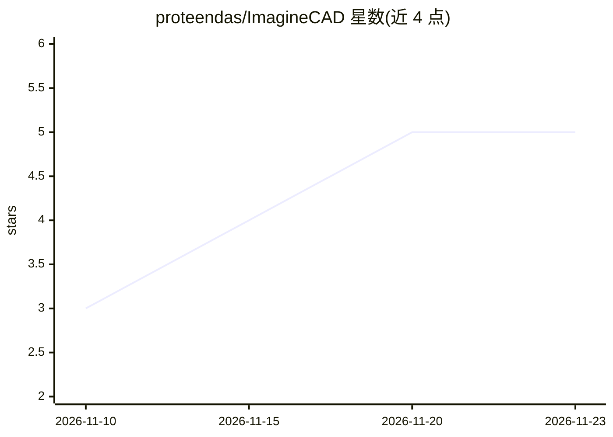

# proteendas/ImagineCAD

⭐ 5 · Rust · GPL-3.0 · 推送 2026-10-16 · [GitHub](https://github.com/proteendas/ImagineCAD) · 个人维护

**面向机械绘图者的 2D CAD，支持手绘草图照片转精确图纸**

以 Rust 编写的跨平台 2D 机械制图 CAD，支持打开与保存 DWG/DXF，提供参数化约束与驱动尺寸、命令行、图层、块、标注、GD&T、标题栏与 PDF/SVG 出图等功能。AI 部分：拍摄手绘草图，由 AI 视觉模型读取手写尺寸并描述零件后生成尺寸精确的可编辑图纸；支持对话式修改图纸。通过安装包分发，也可从源码构建。状态为 early alpha。

## 筛选速览

| 维度 | 判定 | 备注 |
|---|---|---|
| AI 角色 | `ai-enhanced` | 去掉 AI 部分产品仍成立 |
| 许可风险 | `dual` | GPL-3.0 |
| 部署形态 | `desktop` | 安装包/桌面程序 |
| 模型依赖 | local-ok | 支持本地模型 |
| 硬件要求 | — | 无带数字的原话,不猜 |
| 安装摩擦 | `low` | 无编译、无系统依赖或容器化 |
| 成熟度 | `idea` | |

## 能力要点

- 手绘草图照片转尺寸精确的可编辑 CAD 图纸（Image to CAD）
- 自研 Rust DWG 读取器（DWG 2000–2018），保存 DWG 使用内嵌 GNU LibreDWG
- 参数化几何约束与表达式驱动尺寸
- AI Chat 对话式修改图纸，支持任意提供商 API key 或本地模型

## 适用场景

- 将手绘机械草图转换为精确尺寸的 DWG 图纸
- 机械零件的参数化制图与 GD&T 标注
- 通过对话让 AI 修改图纸尺寸与材料属性
- DWG/DXF 文件的打开、编辑与 PDF/SVG 出图

## 场景标签

`图像视频处理` · 领域:感知与多模态

## 证据(README 行号)

> L5:  Professional 2D CAD for mechanical drawings, with AI sketch-to-CAD.
> L19:  AI sketch to CAD
> L36: - **Open, edit and save DWG and DXF.** DWG 2000–2018 drawings are read by ImagineCAD's own DWG reader, written in R
> L40: - **Any AI provider.** Paste any API key (OpenAI, Anthropic, Google Gemini, OpenRouter, Groq, Mistral, xAI, Togethe

## 星数曲线

2026-11-10 3 → 2026-11-23 5（+2）

---
*卡片 v1 · prompt 1.4 · 生成 2026-11-21 · 置信度 high · 依据 README sha `e7e964ba7f85` · [字段定义](../../DATASET.md)*
