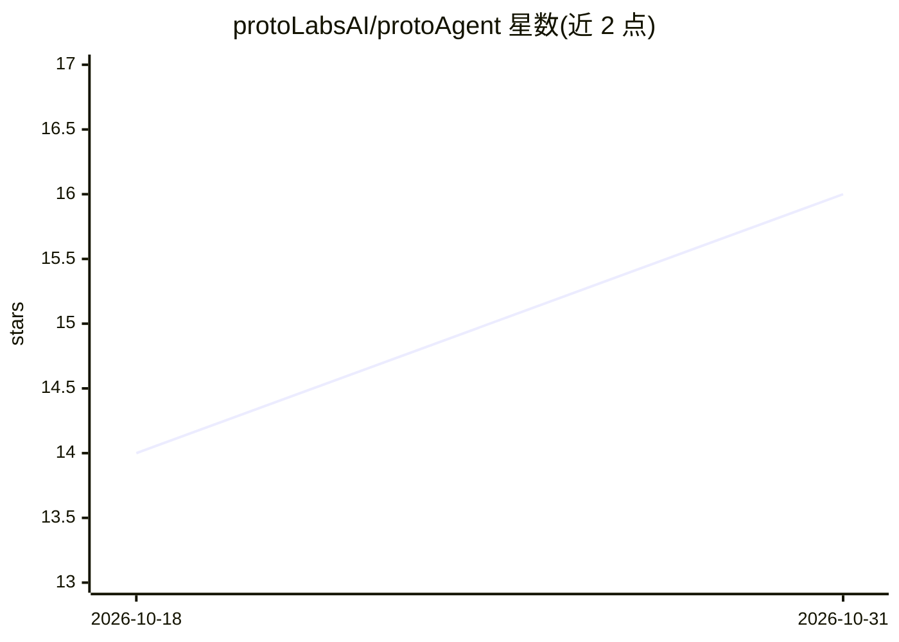

# protoLabsAI/protoAgent

⭐ 16 · Python · MIT · 推送 2026-10-30 · [GitHub](https://github.com/protoLabsAI/protoAgent) · [官网](https://agent.protolabs.studio) · 组织维护

**本地优先的桌面 agent，经 ACP 驱动 Claude Code/Codex 做编码**

运行在本机的插件可扩展桌面 agent：内置规划与记忆（SQLite 本地存储，无遥测），通过 Agent Client Protocol（ACP）把编码任务交给 Claude Code、Codex 等 CLI 编码 agent，并把执行过程流式回传聊天。模型接入支持 Claude Pro/Max、ChatGPT Plus/Pro 计划、OpenAI/OpenRouter API key 或本地模型（Ollama/LM Studio）。插件可从任意 git URL 安装，服务端为 FastAPI + LangGraph 运行时，暴露 OpenAI 兼容 API 与 A2A 1.0。提供桌面安装包、PyPI 包与 Docker 部署；macOS 构建仅支持 Apple Silicon，Windows/Linux 构建未签名。

## 筛选速览

| 维度 | 判定 | 备注 |
|---|---|---|
| AI 角色 | `ai-native` | 本体是模型或模型工具 |
| 许可风险 | `permissive` | MIT |
| 部署形态 | `self-host` | docker 或自建部署 |
| 模型依赖 | local-ok | 支持本地模型 |
| 硬件要求 | — | 无带数字的原话,不猜 |
| 安装摩擦 | `low` | 无编译、无系统依赖或容器化 |
| 成熟度 | — | 结构信号不足 |

## 能力要点

- 经 ACP 将编码任务委托给 Claude Code/Codex 并流式回传
- 聊天、记忆与任务存于本地 SQLite，无分析/追踪/遥测
- 插件从任意 git URL 安装，无需重启即生效
- FastAPI + LangGraph 运行时，暴露 OpenAI 兼容 API 与 A2A 1.0

## 适用场景

- 在本机用对话驱动 Claude Code/Codex 完成编码任务并查看 diff 与测试结果
- 以看板驱动多个 agent 组成开发流水线（brief→PR→CI→merge）
- 离线优先地管理聊天、记忆与知识，数据不离开本地

## 场景标签

`编码 Agent` `AI 助手` · 领域:编码与开发

## 证据(README 行号)

> L3:  Your local agent, handing real coding work to Claude Code and Codex.
> L5:  A private, plugin-extensible desktop agent. It plans and remembers, and it gives the coding
> L6:  to the CLI agents you already use, over the Agent Client Protocol. Your chats, memory and

## 星数曲线

2026-10-18 14 → 2026-10-31 16（+2）

---
*卡片 v1 · prompt 1.4 · 生成 2026-10-30 · 置信度 mid · 依据 README sha `f5ae1d54f056` · [字段定义](../../DATASET.md)*
