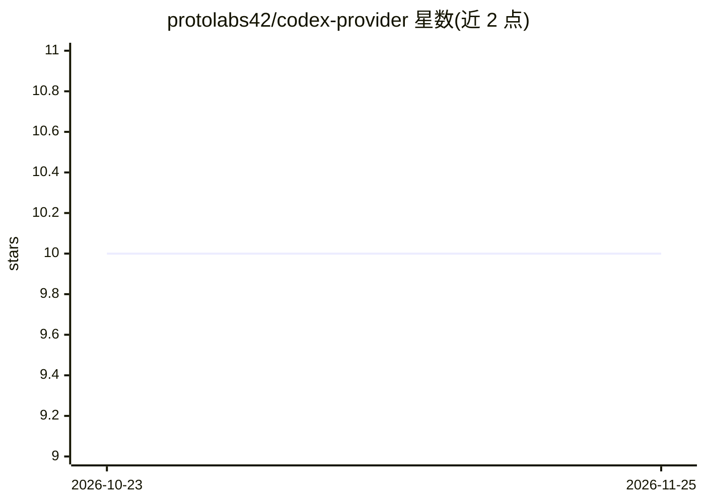

# protolabs42/codex-provider

⭐ 10 · Python · MIT · 推送 2026-03-20 · [GitHub](https://github.com/protolabs42/codex-provider) · 个人维护

**让 Agent Zero 通过 ChatGPT 订阅使用 Codex 模型的代理插件**

面向 Agent Zero 用户的插件：在 Agent Zero 容器内运行本地代理（127.0.0.1:8400），将 LiteLLM 的 OpenAI 兼容调用转发到 chatgpt.com 的后端 Responses API，通过 OpenAI 设备码 OAuth 流程认证，使用 ChatGPT Pro/Plus/Team 订阅而非 API key。支持 gpt-5.x Codex 系列 6 个模型，令牌自动刷新，支持从 Codex CLI 导入令牌或手动导入。要求 Agent Zero 开发分支与 Python 3.12+。

## 筛选速览

| 维度 | 判定 | 备注 |
|---|---|---|
| AI 角色 | `ai-ecosystem` | LLM/agent 周边工具 |
| 许可风险 | `permissive` | MIT |
| 部署形态 | `self-host` | docker 或自建部署 |
| 模型依赖 | — | README 未给出锁定关系 |
| 硬件要求 | — | 无带数字的原话,不猜 |
| 安装摩擦 | `low` | 无编译、无系统依赖或容器化 |
| 成熟度 | — | 结构信号不足 |

## 能力要点

- 本地代理桥接 LiteLLM OpenAI 兼容调用到 ChatGPT 后端 API，无需 API key
- OAuth 设备码流程认证，令牌自动刷新，支持 Codex CLI 令牌导入
- 支持 gpt-5.x Codex 系列 6 个模型，chat completions 自动转 Responses 格式
- 代理仅监听容器内 127.0.0.1:8400，不对外暴露

## 适用场景

- 已有 ChatGPT 订阅，想让 Agent Zero 使用 Codex 模型而不购买 API key
- 在 Agent Zero 中以订阅额度替代按量付费的 API 调用

## 场景标签

`模型网关` · 领域:Agent 开发

## 证据(README 行号)

> L7: This plugin runs a local proxy inside the Agent Zero container that bridges LiteLLM's OpenAI-compatible calls to Cha
> L10: Agent Zero ──► LiteLLM ──► Local Proxy (:8400) ──► chatgpt.com/backend-api/codex/responses

## 星数曲线

2026-10-23 10 → 2026-11-25 10（+0）

---
*卡片 v1 · prompt 1.4 · 生成 2026-11-19 · 置信度 high · 依据 README sha `55587a6c4d76` · [字段定义](../../DATASET.md)*
