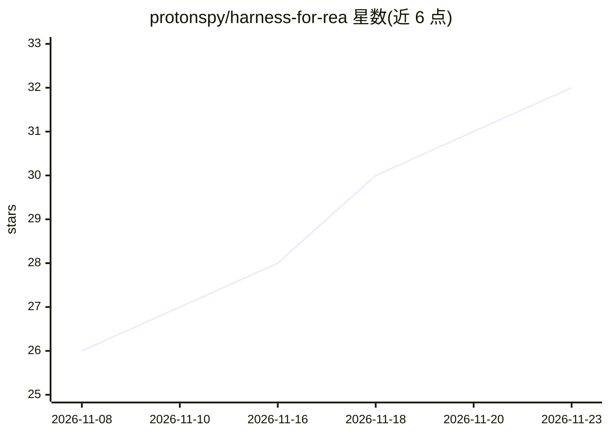

# protonspy/harness-for-rea

⭐ 32 · TypeScript · MIT · 推送 2026-11-11 · [GitHub](https://github.com/protonspy/harness-for-rea) · 组织维护

**双 agent 沙箱化的软件逆向分析桌面应用与终端 UI**

面向拥有或被授权研究的软件的深度分析工具：用户在聊天中提出请求，编排 agent 规划步骤、编写并运行自己的代码，专家 agent 在 Docker 容器中执行深度分析（内置 REA 逆向工程 MCP 服务器，或使用用户 Claude 订阅的 Claude Code）。报告需引用证据并通过 JSON 契约校验，改动以补丁形式返回。通过 MCP 只读集成 Cheat Engine 与 IDA Pro。运行需 Docker、Claude 订阅或编排方 API key（OpenRouter/DeepSeek 等）；未签名发布包需手动放行。

## 筛选速览

| 维度 | 判定 | 备注 |
|---|---|---|
| AI 角色 | `ai-ecosystem` | LLM/agent 周边工具 |
| 许可风险 | `permissive` | MIT |
| 部署形态 | `desktop` | 安装包/桌面程序 |
| 模型依赖 | locked-api |  |
| 硬件要求 | — | 无带数字的原话,不猜 |
| 安装摩擦 | `low` | 无编译、无系统依赖或容器化 |
| 成熟度 | — | 结构信号不足 |

## 能力要点

- 编排/专家双 agent 分工，专家在每步独立的 Docker 容器中运行
- 报告须引用行号/地址/REA 证据 id，JSON 契约校验失败自动退回修正
- replay_vectors 将测试向量与重实现输出逐字节比对
- Cheat Engine 与 IDA Pro 的只读 MCP 桥接，目标须经用户批准

## 适用场景

- 分析自己拥有的遗留系统或二进制并重实现其功能
- 在隔离容器中逆向 APK、可执行文件等目标
- 调试时读取已批准 Windows 进程的实时内存

## 场景标签

`编码 Agent` · 领域:编码与开发

## 证据(README 行号)

> L26: |**The orchestrator**|a model from Hopper (the default), OpenRouter, DeepSeek or any OpenAI-compatible provider|the
> L27: |**The specialist**|a provider's model, Hopper by default, as an agent in the app whose every command and tool runs

## 星数曲线

2026-11-08 26 → 2026-11-23 32（+6）

---
*卡片 v1 · prompt 1.4 · 生成 2026-11-18 · 置信度 mid · 依据 README sha `695a8afd7d7e` · [字段定义](../../DATASET.md)*
