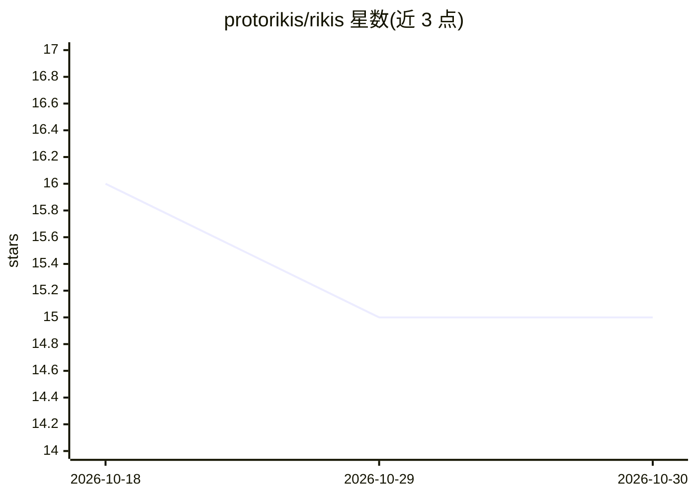

# protorikis/rikis

⭐ 15 · Python · Apache-2.0 · 推送 2026-06-18 · [GitHub](https://github.com/protorikis/rikis) · [官网](https://www.protorikis.com) · 个人维护

**本地 LLM 运行时的基准测试代理：拉取并执行 Bench 任务**

连接本地 LLM 运行时（Ollama、llama.cpp、LM Studio）与 Protorikis Bench 平台的轻量 CLI 代理：用户从平台获取 token 登录，配置本地运行时地址后启动 agent；agent 轮询平台获取基准测试任务，在本地执行推理并回传结果。声明只执行推理、不在本地运行生成的代码。仅依赖 httpx 与 Typer 两个库，通过 pipx 安装。

## 筛选速览

| 维度 | 判定 | 备注 |
|---|---|---|
| AI 角色 | `ai-ecosystem` | LLM/agent 周边工具 |
| 许可风险 | `permissive` | Apache-2.0 |
| 部署形态 | `None` |  |
| 模型依赖 | local-ok | 支持本地模型 |
| 硬件要求 | — | 无带数字的原话,不猜 |
| 安装摩擦 | `low` | 无编译、无系统依赖或容器化 |
| 成熟度 | — | 结构信号不足 |

## 能力要点

- 轮询 Protorikis Bench 拉取基准任务并在本地运行时执行推理
- 支持注册 Ollama、llama.cpp、LM Studio 三种本地运行时
- 仅依赖 httpx 与 Typer，pipx 单命令安装
- 声明只执行推理，不在本地执行生成的代码

## 适用场景

- 把本机 Ollama/llama.cpp/LM Studio 接入 Protorikis Bench 跑基准
- 无需手动搬运任务即可自动接收并回报测试结果

## 场景标签

`模型评测` · 领域:评测与运维

## 证据(README 行号)

> L3: Lightweight agent that connects your local LLM runtimes to Protorikis Bench and runs benchmark jobs on them.
> L34: The agent polls Protorikis Bench for benchmark jobs, runs inference locally, and returns results.

## 星数曲线

2026-10-18 16 → 2026-10-30 15（-1）

---
*卡片 v1 · prompt 1.4 · 生成 2026-10-30 · 置信度 high · 依据 README sha `5845c0344bd9` · [字段定义](../../DATASET.md)*
