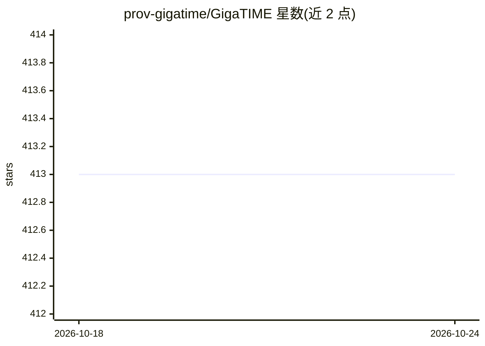

# prov-gigatime/GigaTIME

⭐ 413 · Jupyter Notebook · Apache-2.0 · 推送 2026-08-07 · [GitHub](https://github.com/prov-gigatime/GigaTIME) · 组织维护

**从常规 H&E 病理切片生成虚拟 mIF 空间蛋白质组学图谱的深度学习模型**

GigaTIME 官方实现（Cell 论文），基于 GigaPath 全切片基础模型的跨模态翻译器，从 H&E 染色图像预测多重免疫荧光（mIF）空间蛋白质组学图谱，用于肿瘤微环境建模的虚拟人群生成。提供 GigaTIME-Flash 变体（基于 GigaPath-Flash，推理更快、GPU 显存更少）。以 Conda 环境的 Python 代码与 Jupyter 教程（推理/全切片推断/训练）发布，预训练权重托管于 HuggingFace 与 Azure AI Foundry。仅限研究用途，明确排除临床与部署场景。

## 筛选速览

| 维度 | 判定 | 备注 |
|---|---|---|
| AI 角色 | `ai-native` | 本体是模型或模型工具 |
| 许可风险 | `permissive` | Apache-2.0 |
| 部署形态 | `None` |  |
| 模型依赖 | — | README 未给出锁定关系 |
| 硬件要求 | — | 无带数字的原话,不猜 |
| 安装摩擦 | `medium` | 含编译或系统依赖之一 |
| 成熟度 | — | 结构信号不足 |

## 能力要点

- 从 H&E 切片预测多通道 mIF 空间蛋白质组学图谱
- GigaTIME-Flash 基于 GigaPath-Flash，推理提速 6 倍、GPU 显存降至 1/8
- 提供推理、全切片（WSI）推断与训练的 Jupyter 教程及训练脚本
- 预训练模型发布于 HuggingFace 与 Azure AI Foundry

## 适用场景

- 病理 AI 研究者复现论文实验结果
- 无需 mIF 染色即可从常规 H&E 切片生成虚拟免疫荧光图谱
- 在 GigaTIME 基础上开展肿瘤微环境建模研究

## 场景标签

 · 领域:计算病理学/空间蛋白质组学

## 证据(README 行号)

> L29: |**GigaTIME**|Spatial proteomics prediction from H&E|Cell (2026)|Apache-2.0|
> L113: The primary intended use is to support AI researchers reproducing and building on top of this work. GigaTIME shoul

## 星数曲线

2026-10-18 413 → 2026-10-24 413（+0）

---
*卡片 v1 · prompt 1.4 · 生成 2026-10-21 · 置信度 high · 依据 README sha `401784492c83` · [字段定义](../../DATASET.md)*
