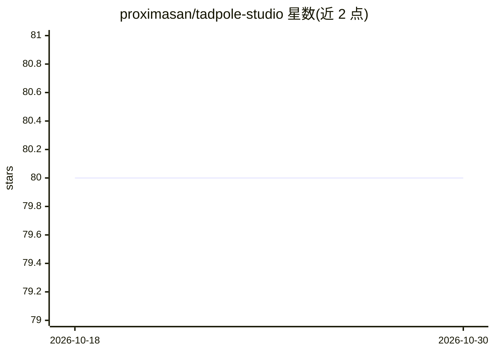

# proximasan/tadpole-studio

⭐ 80 · TypeScript · MIT · 推送 2026-03-05 · [GitHub](https://github.com/proximasan/tadpole-studio) · 个人维护

**本地优先的 AI 音乐生成工作室，基于 ACE-Step 1.5**

面向本地模型的音乐生成桌面 Web 应用：基于 ACE-Step 1.5 提供文本生成音乐、自定义参数（BPM/调性/时长）、Remix 翻唱、Repaint 局部重生成、分轨提取、LoRA 微调等功能；另有对话式 AI DJ（支持 MLX/Ollama/OpenAI/Anthropic）、Jukebox 连续电台模式与曲库管理。后端 FastAPI+SQLite，前端 Next.js/React，一键启动脚本自动装依赖并下载约 10 GB 模型；需 Python 3.11+/Node 20+/pnpm 9+，支持 CUDA/MPS/CPU。

## 筛选速览

| 维度 | 判定 | 备注 |
|---|---|---|
| AI 角色 | `ai-native` | 本体是模型或模型工具 |
| 许可风险 | `permissive` | MIT |
| 部署形态 | `None` |  |
| 模型依赖 | local-ok | 支持本地模型 |
| 硬件要求 | — | 无带数字的原话,不猜 |
| 安装摩擦 | `medium` | 含编译或系统依赖之一 |
| 成熟度 | — | 结构信号不足 |

## 能力要点

- 文本生成音乐/Remix/Repaint/分轨提取等多种生成模式
- 对话式 AI DJ，支持 MLX、Ollama、OpenAI、Anthropic 多提供方
- 一键启动脚本自动安装依赖并从 HuggingFace 下载默认模型（约 10 GB）
- LoRA 微调与数据集管理、按 VRAM 分档的 LM 模型选择

## 适用场景

- 在自己电脑上从文字描述生成或翻唱音乐
- 通过对话让 AI DJ 按描述连续生成音乐（电台模式）
- 用自己的音频数据集微调音乐生成模型

## 场景标签

`微调` · 领域:训练与推理

## 证据(README 行号)

> L3: **Local-first AI music generation studio**
> L15: Generate, remix, and manage AI music entirely on your own machine.
> L38: - **Text-to-Music (Simple Mode)** — describe what you want, get a song

## 星数曲线

2026-10-18 80 → 2026-10-30 80（+0）

---
*卡片 v1 · prompt 1.4 · 生成 2026-10-24 · 置信度 high · 依据 README sha `6c7bdc0fef48` · [字段定义](../../DATASET.md)*
