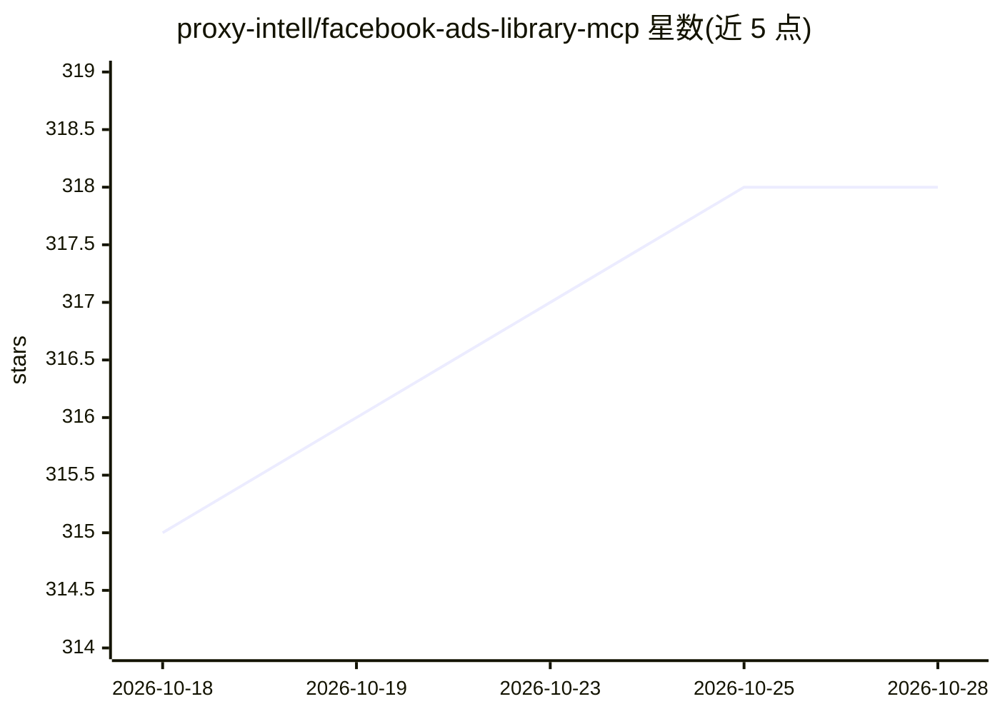

# proxy-intell/facebook-ads-library-mcp

⭐ 319 · Python · MIT · 推送 2026-10-24 · [GitHub](https://github.com/proxy-intell/facebook-ads-library-mcp) · [官网](https://useproxy.dev/) · 组织维护

**查询分析 Facebook 广告库的 MCP 服务器，供营销人员使用**

Model Context Protocol 服务器，连接 Claude Desktop、Cursor、ChatGPT 等 MCP 客户端，通过 ScrapeCreators API 检索 Facebook 公开广告库数据，提供品牌广告获取、广告图文/视频分析（视频分析用 Gemini）、多品牌批量对比等工具，带缓存与额度监控。提供 useproxy.dev 托管版（免 API key）与 Python 自托管两种使用方式；自托管需 Python 3.12+、ScrapeCreators key，视频分析另需 Gemini key（可选）。

## 筛选速览

| 维度 | 判定 | 备注 |
|---|---|---|
| AI 角色 | `ai-ecosystem` | LLM/agent 周边工具 |
| 许可风险 | `permissive` | MIT |
| 部署形态 | `library` | 以包/库形式分发 |
| 模型依赖 | — | README 未给出锁定关系 |
| 硬件要求 | — | 无带数字的原话,不猜 |
| 安装摩擦 | `low` | 无编译、无系统依赖或容器化 |
| 成熟度 | — | 结构信号不足 |

## 能力要点

- 8 个 MCP 工具：广告检索、图文分析、Gemini 视频分析、批量视频分析、媒体缓存管理
- 自托管与 Proxy (useproxy.dev) 托管版两种形态
- 智能缓存与批量查询减少 API 调用（批量视频称约省 88% token）
- 支持 ChatGPT、Claude、Cursor、Manus 等 MCP 客户端

## 适用场景

- 分析某品牌当前投放的广告数量与图文/视频创意
- 横向对比多家竞品的广告策略与信息主题
- 在 Claude 或 Cursor 中直接用自然语言查询广告库

## 场景标签

`网页抓取` `数据分析` · 领域:效率与自动化

## 证据(README 行号)

> L7: This is a Model Context Protocol (MCP) server for the Facebook Ads Library.
> L141: 1. Claude sends requests to the Python MCP server

## 星数曲线

2026-10-18 315 → 2026-10-28 318（+3）

---
*卡片 v1 · prompt 1.4 · 生成 2026-10-21 · 置信度 mid · 依据 README sha `b8148afa7860` · [字段定义](../../DATASET.md)*
