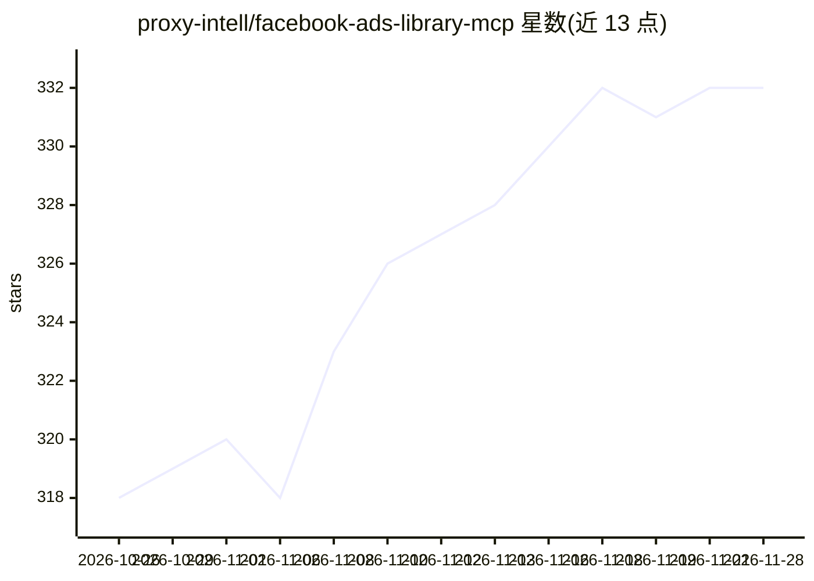

# proxy-intell/facebook-ads-library-mcp

⭐ 332 · Python · MIT · 推送 2026-11-21 · [GitHub](https://github.com/proxy-intell/facebook-ads-library-mcp) · [官网](https://useproxy.dev/) · 组织维护

**把 Facebook 广告资料库接入 MCP 客户端的查询服务器**

一个面向 Facebook（Meta）广告资料库的 Model Context Protocol 服务器，提供品牌广告检索、全库关键词搜索、广告图片/视频分析、跨公司策略对比与竞品追踪等工具，并内置五个研究 playbook。视频分析依赖 Google Gemini API，广告数据通过 ScrapeCreators API 获取并按调用计费。自托管版仅覆盖 Meta 平台，维护方另提供覆盖四平台的托管版 Proxy（useproxy.dev）。支持 Python/Docker 安装及 Render 云部署，客户端为 Claude Desktop、Claude Code 或 Cursor。

## 筛选速览

| 维度 | 判定 | 备注 |
|---|---|---|
| AI 角色 | `ai-ecosystem` | LLM/agent 周边工具 |
| 许可风险 | `permissive` | MIT |
| 部署形态 | `self-host` | docker 或自建部署 |
| 模型依赖 | — | README 未给出锁定关系 |
| 硬件要求 | — | 无带数字的原话,不猜 |
| 安装摩擦 | `low` | 无编译、无系统依赖或容器化 |
| 成熟度 | — | 结构信号不足 |

## 能力要点

- 品牌检索、全库关键词搜索与'自上次拉取以来的变化'追踪
- analyze_ad_video 借助 Gemini 做视频广告分析（需 GEMINI_API_KEY）
- 五个内置研究 playbook 与媒体缓存管理工具
- 提供 git clone 安装脚本、手动安装、Docker 与 Render 部署四种途径

## 适用场景

- 在 Claude Desktop/Cursor 里查询某品牌当前投放的广告与素材策略
- 按关键词搜索全库并按广告主分组分析
- 定期拉取竞品广告并对比新增内容
- 批量对比多家公司的广告量、信息主题与创意手法

## 场景标签

`数据分析` `科研工具` · 领域:效率与自动化

## 证据(README 行号)

> L13: This is a Model Context Protocol (MCP) server for the Facebook Ads Library.
> L204: 1. Claude sends requests to the Python MCP server

## 星数曲线

2026-10-26 318 → 2026-11-28 332（+14）

---
*卡片 v1 · prompt 1.4 · 生成 2026-11-25 · 置信度 high · 依据 README sha `26e70f96d81b` · [字段定义](../../DATASET.md)*
