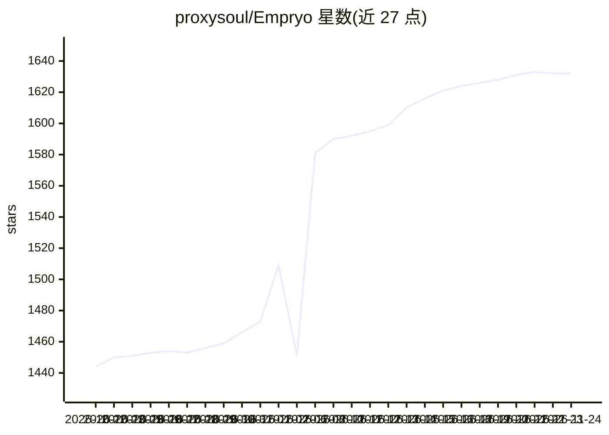

# proxysoul/Empryo

⭐ 1,634 · TypeScript · NOASSERTION · 推送 2026-11-18 · [GitHub](https://github.com/proxysoul/Empryo) · [官网](https://empryo.com/) · 组织维护

**面向桌面、终端与 CI 的 AI 编码 harness：映射仓库并按符号编辑代码**

Empryo 是一个 AI 编码 harness，提供桌面、终端与无头三种运行形态。它对仓库建图，通过 AST 与语言服务器（LSP）按函数/类符号精确编辑代码，并在同一轮内运行用户项目检测出的 typecheck、lint 与测试命令来校验修改；按项目记录决策与历史缺陷。代码智能开箱即用，自动安装所需语言服务器，无需配置。连接任意模型或已有订阅计划后即可使用。仓库仅含 SoulForge v2 核心与引擎代码，v3 桌面应用为私有开发，商业分发需另行许可。

## 筛选速览

| 维度 | 判定 | 备注 |
|---|---|---|
| AI 角色 | `ai-ecosystem` | LLM/agent 周边工具 |
| 许可风险 | `none` | NOASSERTION |
| 部署形态 | `None` |  |
| 模型依赖 | — | README 未给出锁定关系 |
| 硬件要求 | — | 无带数字的原话,不猜 |
| 安装摩擦 | `low` | 无编译、无系统依赖或容器化 |
| 成熟度 | — | 结构信号不足 |

## 能力要点

- 仓库建图后按符号（函数/类）精确编辑代码
- 自动检测并运行项目的 typecheck、lint 与测试自检
- 桌面、终端、headless CI 三种形态共享同一地图与记忆
- 支持连接任意模型或已有订阅计划

## 适用场景

- 让 agent 在 CI 中无头运行完成代码修改与自检
- 在桌面应用中查看仓库实时依赖地图与编辑 diff
- 在终端里按符号精准重构函数或类

## 场景标签

`编码 Agent` · 领域:编码与开发

## 证据(README 行号)

> L29: Then connect a model and prompt. Code intelligence works out of the box: Empryo maps your code, installs the langua
> L33: - **It reads the map first.** It knows what an edit will touch before it makes it.
> L56: This repository contains the public SoulForge v2 core and engine code under its existing license. It is not the ful

## 星数曲线

2026-10-22 1,444 → 2026-11-24 1,632（+188）

---
*卡片 v1 · prompt 1.4 · 生成 2026-11-23 · 置信度 high · 依据 README sha `78ccd1d9f477` · [字段定义](../../DATASET.md)*
