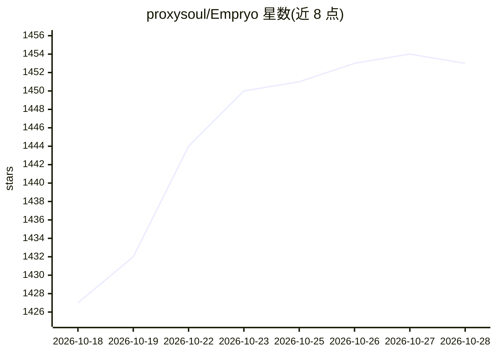

# proxysoul/Empryo

⭐ 1,453 · TypeScript · NOASSERTION · 推送 2026-10-16 · [GitHub](https://github.com/proxysoul/Empryo) · [官网](https://empryo.com/) · 个人维护

**面向桌面、终端与 CI 的 AI 编码代理，按符号编辑代码并跑检查**

Empryo 是一个 AI coding harness，覆盖桌面应用、终端与 headless CI 三种运行形态，共享同一份仓库映射与项目记忆。机制上先通过 AST 与 LSP 读取仓库结构，按函数/类名做符号级精确编辑，随后在同轮运行类型检查、lint 与测试并修复；按项目记录决策与历史 bug。支持接入任意模型或已有付费套餐。本仓库仅含 SoulForge v2 公开核心与引擎代码，v3 桌面版闭源开发；v3 个人与内部商业使用免费，转售或托管 Empryo 本身需另行商业许可。

## 筛选速览

| 维度 | 判定 | 备注 |
|---|---|---|
| AI 角色 | `ai-native` | 本体是模型或模型工具 |
| 许可风险 | `none` | NOASSERTION |
| 部署形态 | `None` |  |
| 模型依赖 | — | README 未给出锁定关系 |
| 硬件要求 | — | 无带数字的原话,不猜 |
| 安装摩擦 | `low` | 无编译、无系统依赖或容器化 |
| 成熟度 | — | 结构信号不足 |

## 能力要点

- 基于 AST/LSP 的仓库映射与符号级编辑
- 同轮内运行类型检查、lint、测试并自我修复
- 桌面、终端、headless CI 三形态共享同一映射与记忆
- 支持任意模型或已付费的套餐

## 适用场景

- 在桌面应用中查看仓库依赖地图并让 AI 按符号改代码
- 在终端或 CI 中以 headless 方式运行编码代理
- 按项目保留决策与历史 bug 记忆以延续上下文

## 场景标签

`编码 Agent` · 领域:编码与开发

## 证据(README 行号)

> L16:  Empryo maps a repository, follows its connections, edits code and shows the diff in desktop and terminal views
> L31: - **It reads the map first.** It knows what an edit will touch before it makes it.

## 星数曲线

2026-10-18 1,427 → 2026-10-28 1,453（+26）

---
*卡片 v1 · prompt 1.4 · 生成 2026-10-21 · 置信度 high · 依据 README sha `c74d27d8654d` · [字段定义](../../DATASET.md)*
