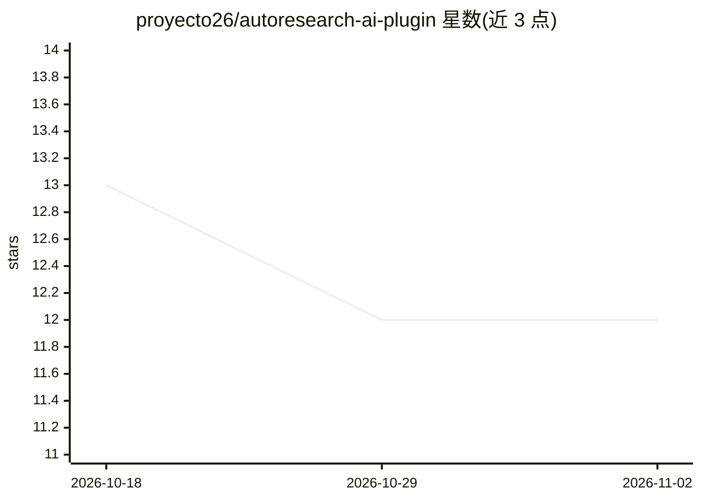

# proyecto26/autoresearch-ai-plugin

⭐ 12 · Shell · MIT · 推送 2026-07-18 · [GitHub](https://github.com/proyecto26/autoresearch-ai-plugin) · 个人维护

**给 Claude Code 的自主实验循环插件：改代码→测基准→只留改进**

面向 Claude Code 的插件，提供两个技能与 /run-autoresearch 命令及 Orchestrator 子代理：Autoresearch 为领域无关的自主优化循环（编辑代码→运行基准→按指标保留或 git revert），状态持久化在 autoresearch.jsonl，支持上下文重置后无损恢复、MAD 置信评分与确定性停止规则；Autoresearch ML 面向 NVIDIA GPU 上的 LLM 预训练实验（4GB–80GB 显存分档，每实验固定 5 分钟，val_bpb 指标）。另含文件保护 hooks（防止基准脚本被中途改动）。通过 Claude Code 插件系统、npx skills、git clone/ submodule 等方式安装；ML skill 需 CUDA 12.0+ 与 Python 3.10+。

## 筛选速览

| 维度 | 判定 | 备注 |
|---|---|---|
| AI 角色 | `ai-ecosystem` | LLM/agent 周边工具 |
| 许可风险 | `permissive` | MIT |
| 部署形态 | `library` | 以包/库形式分发 |
| 模型依赖 | locked-api |  |
| 硬件要求 | — | 无带数字的原话,不猜 |
| 安装摩擦 | `medium` | 含编译或系统依赖之一 |
| 成熟度 | — | 结构信号不足 |

## 能力要点

- 自主实验循环：编辑→基准测量→按指标 keep/revert，状态持久化可跨会话恢复
- 任意可测指标可优化（测试耗时、包体积、构建时间、Lighthouse 分数等）
- ML skill 提供 GPT+Flash Attention+MuonAdamW 预训练模板，支持 GTX 1080 Ti 到 H100 的 VRAM 分档
- PreToolUse hooks 保护基准脚本等敏感文件以保证实验可比性

## 适用场景

- 让 Claude Code 夜间自动迭代优化测试耗时或包体积
- 在自有 NVIDIA GPU 上自动跑 LLM 预训练实验并保留有效改进
- 以结构化实验日志（含 ASI 注解）追踪被丢弃实验的线索

## 场景标签

`编码 Agent` `模型训练` · 领域:编码与开发

## 证据(README 行号)

> L13: This plugin provides two skills that work together. **Autoresearch** is the core engine (works for any metric), and
> L42: - **`/run-autoresearch [goal]`** — one command to run a session end-to-end: it gathers goal/benchmark/metric (askin
> L56: #### Option 1: Claude Code Plugin (Recommended — full experience)

## 星数曲线

2026-10-18 13 → 2026-11-02 12（-1）

---
*卡片 v1 · prompt 1.4 · 生成 2026-11-01 · 置信度 high · 依据 README sha `f60f43346f9e` · [字段定义](../../DATASET.md)*
