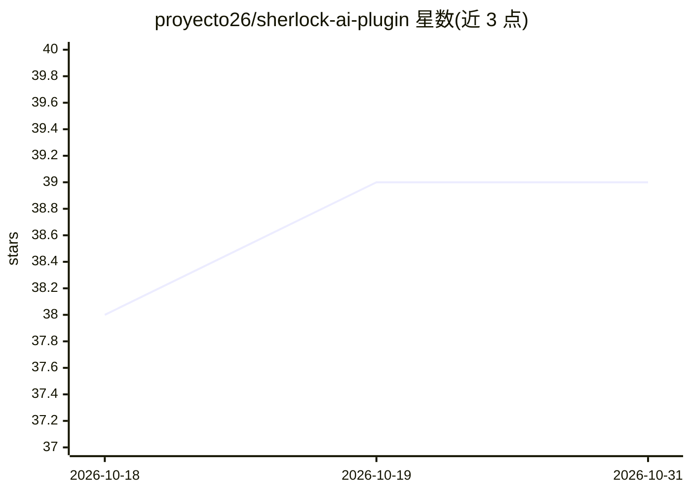

# proyecto26/sherlock-ai-plugin

⭐ 39 · TypeScript · MIT · 推送 2026-08-31 · [GitHub](https://github.com/proyecto26/sherlock-ai-plugin) · 个人维护

**面向 Claude Code/Cursor 等的科研论文技能插件合集（6 个技能）**

Sherlock 是一组可安装到 AI 编程代理宿主的技能集，含 Paper2Code（论文转代码，4 阶段流水线）、Deep Research（多子代理并行起草带引用报告）、Paper Comic（论文转漫画，Gemini 生成图像）、Paper Analyzer（MinerU 解析 PDF 公式表格）、GenImg Gemini Web（图像生成）与 Visual Architect（方法论结构图/绘图提示词）。遵循 Agent Plugins 1.0 开放标准，可装到 Claude Code、OpenAI Codex、Copilot CLI、Cursor 等宿主。部分技能需 MinerU token 或 Google 登录会话。

## 筛选速览

| 维度 | 判定 | 备注 |
|---|---|---|
| AI 角色 | `ai-knowledge` | 知识聚合/清单类 |
| 许可风险 | `permissive` | MIT |
| 部署形态 | `library` | 以包/库形式分发 |
| 模型依赖 | — | README 未给出锁定关系 |
| 硬件要求 | — | 无带数字的原话,不猜 |
| 安装摩擦 | `low` | 无编译、无系统依赖或容器化 |
| 成熟度 | — | 结构信号不足 |

## 能力要点

- Paper2Code 四阶段论文转代码流水线，强制 YAML 中间表示
- Deep Research 并行子代理起草、证据引用表追踪
- Paper Analyzer 经 MinerU 解析 PDF 公式/表格/LaTeX
- 兼容 Agent Plugins 1.0 标准，覆盖 Claude Code/Codex/Copilot CLI/Cursor

## 适用场景

- 让 AI 代理把学术论文方法复现为可运行代码
- 生成带严格引用的多页深度调研报告
- 把复杂论文转成教育漫画或结构示意图
- 解析 PDF 论文的公式、表格与元数据

## 场景标签

`科研工具` `图像生成` `文档解析` · 领域:内容生成

## 证据(README 行号)

> L11: Sherlock is a curated collection of high-powered AI skills designed to transform your research workflow. It doesn't
> L86: This plugin follows the Agent Plugins 1.0

## 星数曲线

2026-10-18 38 → 2026-10-31 39（+1）

---
*卡片 v1 · prompt 1.4 · 生成 2026-10-25 · 置信度 high · 依据 README sha `3ec3d2a3ab1a` · [字段定义](../../DATASET.md)*
