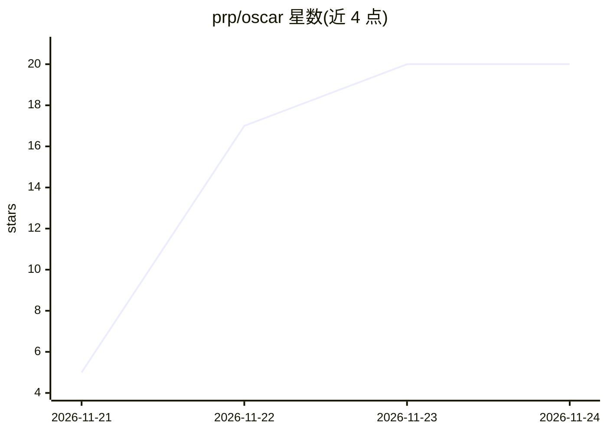

# prp/oscar

⭐ 20 · Rust · Apache-2.0 · 推送 2026-11-20 · [GitHub](https://github.com/prp/oscar) · 组织维护

**让 Apple Silicon Mac 以弹性内存运行超内存大型 MoE 模型**

用 Rust 编写的 LLM offloading 服务，通过弹性内存管理、事件驱动统一内存引擎、路由感知专家预取与自草稿等机制，在 Apple Silicon 上运行超出机器内存的量化开源 MoE 模型。提供 OpenAI 兼容 API 服务器、终端聊天、菜单栏应用与 CLI，支持从 Hugging Face 下载 Qwen/GLM/Kimi 系列模型。限制：仅支持 macOS 27+ 与 M1–M5 芯片，模型超出内存倍数越大解码速度越低。

## 筛选速览

| 维度 | 判定 | 备注 |
|---|---|---|
| AI 角色 | `ai-ecosystem` | LLM/agent 周边工具 |
| 许可风险 | `permissive` | Apache-2.0 |
| 部署形态 | `desktop` | 安装包/桌面程序 |
| 模型依赖 | — | README 未给出锁定关系 |
| 硬件要求 | — | 无带数字的原话,不猜 |
| 安装摩擦 | `low` | 无编译、无系统依赖或容器化 |
| 成熟度 | — | 结构信号不足 |

## 能力要点

- 弹性内存管理：按需占用/归还空闲内存，类似 OS page cache
- OpenAI 兼容 API 服务器，支持流式输出、tool calling 与 reasoning 输出
- 自定义 Metal GPU 内核直接在量化权重上计算（1–8 bit）
- 全本地运行：提示与输出不离开本机

## 适用场景

- 在 64GB 内存的 MacBook 上运行数百 GB 的大型 MoE 模型
- 本地部署 OpenAI 兼容 API 供其他客户端接入
- 配合 OpenCode 做本地 agentic coding

## 场景标签

`推理引擎` · 领域:训练与推理

## 证据(README 行号)

> L1: # Oscar: Elastic LLM Serving for Larger-than-Memory LLMs on Apple Silicon
> L3: Oscar is an elastic LLM offloading service for Apple Silicon machines, written in Rust, that runs mixture-of-experts
> L26: - 🔌 **OpenAI-compatible API server** with streaming chat completions, tool calling and reasoning output

## 星数曲线

2026-11-21 5 → 2026-11-24 20（+15）

---
*卡片 v1 · prompt 1.4 · 生成 2026-11-21 · 置信度 high · 依据 README sha `c3323bdd90ed` · [字段定义](../../DATASET.md)*
