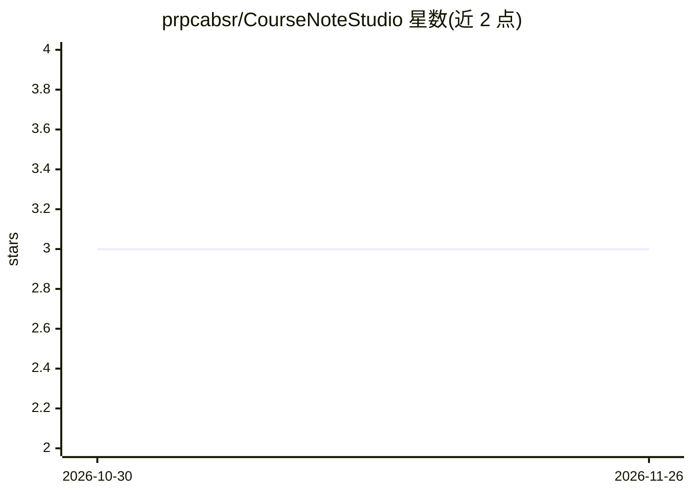

# prpcabsr/CourseNoteStudio

⭐ — · [GitHub]() · 个人维护 · 中文 README

**把大学课程视频转成结构化可打印 PDF 笔记的本地工具**

基于 Node.js 的 Windows 桌面工具：输入课程视频链接（B 站/YouTube/慕课）或本地文件，逐秒追踪黑板板书并在擦除前保存最完整一屏，用 sherpa-onnx+SenseVoice 本地转写语音，经 llama.cpp 运行本地 Qwen3-VL 视觉模型识别板书，再由大模型整理成带公式的 PDF。提供笔记内 AI 问答、AI 补充旁批、自动审校、整章做题技巧与全局搜索。组件约 3.5 GB 一键下载，全部本地处理；文本模型也可接任意 OpenAI 兼容接口。

## 筛选速览

| 维度 | 判定 | 备注 |
|---|---|---|
| AI 角色 | `ai-native` | 本体是模型或模型工具 |
| 许可风险 | `permissive` | — |
| 部署形态 | `None` |  |
| 模型依赖 | — | README 未给出锁定关系 |
| 硬件要求 | — | 无带数字的原话,不猜 |
| 安装摩擦 | `medium` | 含编译或系统依赖之一 |
| 成熟度 | — | 结构信号不足 |

## 能力要点

- 板书增量抓拍+擦除检测：每块板书只保留擦除前最完整的一屏
- 本地语音识别（sherpa-onnx + SenseVoice）与本地视觉模型（Qwen3-VL-4B via llama.cpp）
- AI 问答面板、手写体旁批补充、自动审校并标注与视频时间不符处
- 支持多选集合集批量解析、任务排队、全局原话/AI 模糊搜索

## 适用场景

- 把网课视频整理成可打印的复习笔记
- 抢救老师擦掉之前的板书内容
- 笔记里划选文字直接向 AI 提问
- 跨多讲合成整章做题手册

## 场景标签

`语音识别` `文档问答` · 领域:知识与检索

## 证据(README 行号)

> L3: 把一节大学课程视频（链接或本地文件）变成一份**完整、结构化、可打印的 PDF 课程笔记**。
> L190: |3|**听**视频音频|sherpa-onnx + SenseVoice 中文转写，带时间戳，标点恢复|✅|
> L191: |4|**加入思考**|整理阶段由大模型按逻辑重组，补充推导动机、易错点（标记为「▸ 理解」，与老师原话区分），并生成复习自测题|✅|

## 星数曲线

2026-10-30 3 → 2026-11-26 3（+0）

---
*卡片 v1 · prompt 1.4 · 生成 2026-11-22 · 置信度 high · 依据 README sha `294b59ceeabc` · [字段定义](../../DATASET.md)*
