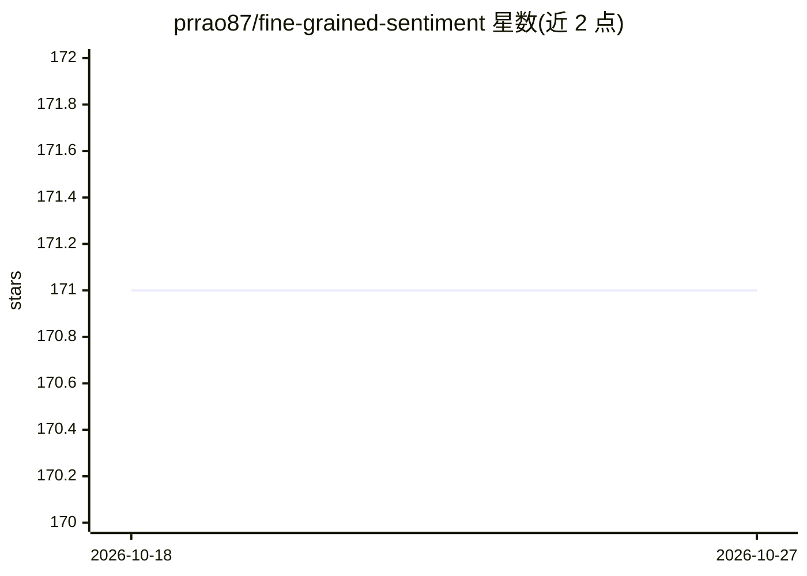

# prrao87/fine-grained-sentiment

⭐ 171 · Python · MIT · 推送 2026-04-18 · [GitHub](https://github.com/prrao87/fine-grained-sentiment) · 个人维护

**SST-5 五类情感分类的多方法对比实验仓库**

在 Stanford Sentiment Treebank (SST-5) 数据集上实现并对比 7 种情感分类方法：规则型（TextBlob、VADER）、线性模型（逻辑回归、SVM+TF-IDF）、嵌入/神经网络型（FastText、Flair 堆叠嵌入、基于 GPT-2 架构缩小版的因果 Transformer）。提供训练脚本、批量预测与混淆矩阵输出，并用 LIME 对预测做逐 token 解释（规则型方法用分箱+正态分布模拟类概率，作者自述该做法 hacky）。训练以 Python 虚拟环境+requirements.txt 安装，GPU 训练 Flair/Transformer 可耗时数小时到一天以上。

## 筛选速览

| 维度 | 判定 | 备注 |
|---|---|---|
| AI 角色 | `ai-native` | 本体是模型或模型工具 |
| 许可风险 | `permissive` | MIT |
| 部署形态 | `library` | 以包/库形式分发 |
| 模型依赖 | — | README 未给出锁定关系 |
| 硬件要求 | — | 无带数字的原话,不猜 |
| 安装摩擦 | `low` | 无编译、无系统依赖或容器化 |
| 成熟度 | — | 结构信号不足 |

## 能力要点

- 7 种分类方法（规则/线性/神经网络）在 SST-5 上的统一实现与对比
- 因果 Transformer 支持 adapter 参数高效微调（可训练参数降至约 25%）
- predictor.py 批量运行多模型并输出各模型混淆矩阵
- LIME 解释器输出 HTML 格式的逐 token 特征影响

## 适用场景

- 对比不同 NLP 方法在细粒度情感分类上的表现
- 复用训练脚本做 SST-5 基线实验
- 用 LIME 解释情感分类器预测结果

## 场景标签

`模型评测` · 领域:评测与运维

## 证据(README 行号)

> L2: This repo shows a comparison and discussion of various NLP methods to perform 5-class sentiment classification on th
> L5:  - **TextBlob**: Rule-based, uses the internal `polarity` metric from the TextBlob library.
> L11:  - **Causal Transformer**: Trains a small transformer model based on OpenAI's GPT-2 architecture (but *much* smalle

## 星数曲线

2026-10-18 171 → 2026-10-27 171（+0）

---
*卡片 v1 · prompt 1.4 · 生成 2026-10-22 · 置信度 mid · 依据 README sha `01dd72dbfcf6` · [字段定义](../../DATASET.md)*
