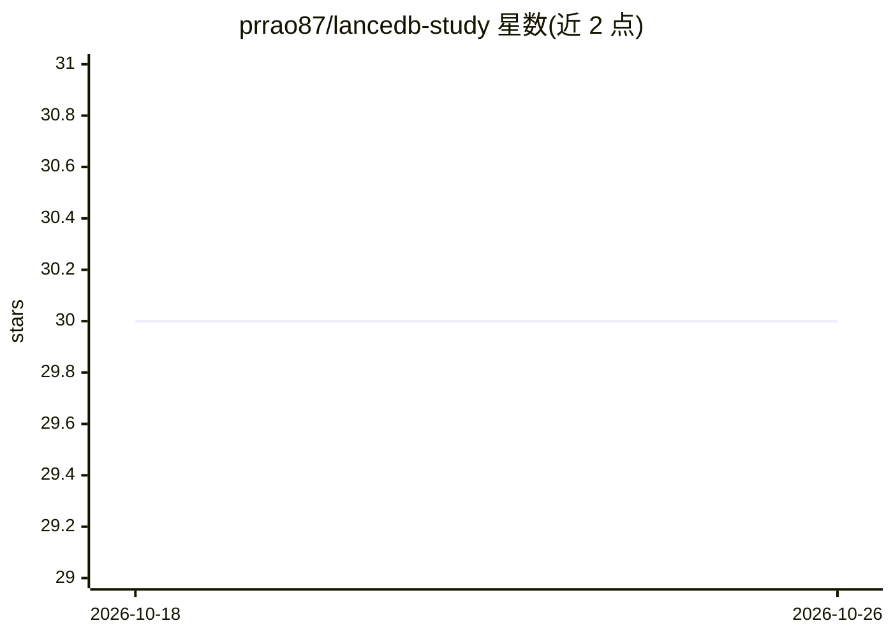

# prrao87/lancedb-study

⭐ 30 · Python · MIT · 推送 2026-02-08 · [GitHub](https://github.com/prrao87/lancedb-study) · 个人维护

**LanceDB 与 Elasticsearch 全文/向量检索性能对比基准项目**

在 Wine Reviews 数据集上对 LanceDB 与 Elasticsearch 做可复现的全文检索（FTS）与向量检索基准测试。提供两种模式：异步 Python 客户端直连与经 FastAPI REST 服务端到端测试；每种检索类型 1000 条查询、3 次试验取平均，输出 QPS 与 P50/P95/P99 延迟。嵌入用 Hugging Face 的 nomic-ai/modernbert-embed-base（256 维）。通过 uv 管理依赖，Elasticsearch 部分需 Docker 容器与数据库密码配置。README 同时提示结果受索引策略、运行时、API 开销等多因素影响。

## 筛选速览

| 维度 | 判定 | 备注 |
|---|---|---|
| AI 角色 | `ai-ecosystem` | LLM/agent 周边工具 |
| 许可风险 | `permissive` | MIT |
| 部署形态 | `self-host` | docker 或自建部署 |
| 模型依赖 | — | README 未给出锁定关系 |
| 硬件要求 | — | 无带数字的原话,不猜 |
| 安装摩擦 | `low` | 无编译、无系统依赖或容器化 |
| 成熟度 | — | 结构信号不足 |

## 能力要点

- 双模式测试：异步客户端直连与 FastAPI 端到端
- 固定协议：每检索类型 1000 条查询、3 次试验，输出 QPS 与 P50/P95/P99
- 使用 nomic-ai/modernbert-embed-base（256 维）生成嵌入
- 附两组完整基准结果数据表

## 适用场景

- 在全文与向量检索场景下比较 LanceDB 与 Elasticsearch 的性能数据
- 复现基准流程或替换数据集自建类似测试
- 了解索引策略、API 开销等因素对检索性能的影响

## 场景标签

 · 领域:数据库/检索性能评测

## 证据(README 行号)

> L3: Reproducible benchmark project comparing full-text search (FTS) and vector search between LanceDB and Elasticsearch 
> L32: The benchmark is run in two modes: a) using the async Python clients directly in LanceDB and Elasticsearch, and b) 
> L42: The `nomic-ai/modernbert-embed-base` embedding model on Hugging Face, with 256 dimensions, is used for generating e

## 星数曲线

2026-10-18 30 → 2026-10-26 30（+0）

---
*卡片 v1 · prompt 1.4 · 生成 2026-10-26 · 置信度 mid · 依据 README sha `47e024de4e38` · [字段定义](../../DATASET.md)*
