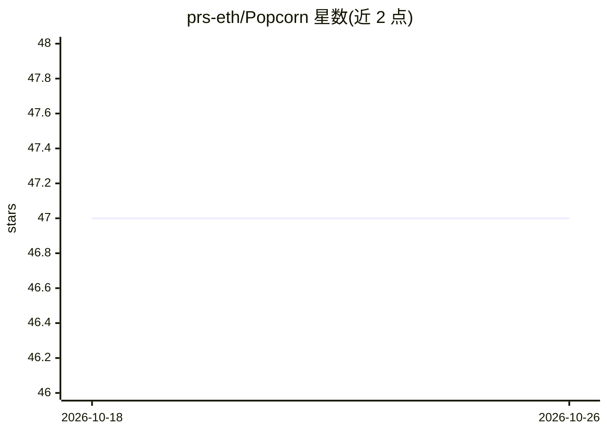

# prs-eth/Popcorn

⭐ 47 · Jupyter Notebook · Apache-2.0 · 推送 2026-01-22 · [GitHub](https://github.com/prs-eth/Popcorn) · [官网](https://popcorn-population.github.io/) · 组织维护

**卫星影像生成高分辨率人口图的深度学习方法（ETH 研究）**

ETH Zürich 与 EPFL 团队发布的科研代码（RSE 2024 论文），用免费的 Sentinel-1/-2 卫星影像加少量粗粒度普查计数，通过冻结的建筑区提取器与弱监督训练的建筑占用率模块，生成 10m 分辨率（推荐聚合至 1ha 网格）的人口分布图。模型可重复应用以追踪人口变化，并可迁移到地理相似区域。提供训练、推理脚本与预训练 checkpoint，实验可运行于 <24GB GPU 内存；数据可经 Google Earth Engine 或 Microsoft Planetary Computer 管线下载，需编译安装 GDAL。

## 筛选速览

| 维度 | 判定 | 备注 |
|---|---|---|
| AI 角色 | `ai-native` | 本体是模型或模型工具 |
| 许可风险 | `permissive` | Apache-2.0 |
| 部署形态 | `library` | 以包/库形式分发 |
| 模型依赖 | — | README 未给出锁定关系 |
| 硬件要求 | `gpu-24g` | |
| 安装摩擦 | `medium` | 含编译或系统依赖之一 |
| 成熟度 | — | 结构信号不足 |

## 能力要点

- 仅用 Sentinel-1/-2 影像与少量粗普查计数即可生成 10m 分辨率人口图
- 弱监督的建筑占用率模块与可解释的建筑区/占用率中间输出
- 提供训练、推理脚本、预训练 checkpoint 与完整数据复现管线
- GEE 与 Microsoft Planetary Computer 两种原始数据下载管线

## 适用场景

- 为缺乏细粒度普查数据的地区绘制高分辨率人口图
- 追踪区域人口随时间的变化
- 制作卢旺达、瑞士、波多黎各等已支持区域的人口分布图层

## 场景标签

 · 领域:遥感/地球观测（人口制图）

## 证据(README 行号)

> L41: To address it we have developed POPCORN, a population mapping method whose only inputs are free, globally available
> L61: The core of our method is a neural network model, termed POPCORN. That model has two components: (1) a pre-trained,

## 星数曲线

2026-10-18 47 → 2026-10-26 47（+0）

---
*卡片 v1 · prompt 1.4 · 生成 2026-10-25 · 置信度 high · 依据 README sha `2202c60ccf85` · [字段定义](../../DATASET.md)*
