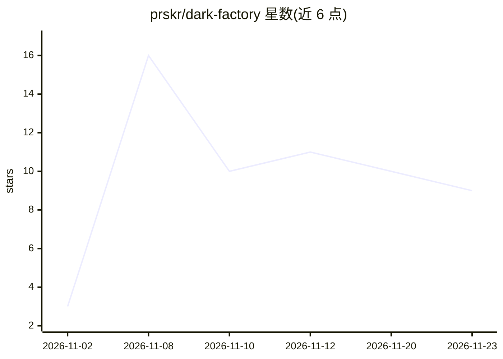

# prskr/dark-factory

⭐ 9 · Rust · 推送 2026-11-22 · [GitHub](https://github.com/prskr/dark-factory) · [官网](http://www.dark-factory.eu/) · 个人维护

**Kubernetes 原生控制平面：在自有集群运行 AI 编码 agent**

面向 homelab 的轻量级 Kubernetes 原生控制平面，将 AI 编码 agent 作为"员工"管理：用户提交 Git 仓库、issue 跟踪器与沙箱镜像，创建任务并分配给 agent；每次运行使用独立 Kubernetes pod，内部 Rust 运行时通过 ACP 驱动 Claude Code 等 harness，经 gRPC/mTLS 回连控制平面，并在 forge 中打开 draft PR。集成以 WASI 插件实现（Forgejo、GitHub）。状态为 pre-MVP，无发布版本，破坏性变更预期存在。

## 筛选速览

| 维度 | 判定 | 备注 |
|---|---|---|
| AI 角色 | `ai-ecosystem` | LLM/agent 周边工具 |
| 许可风险 | `none` | — |
| 部署形态 | `None` |  |
| 模型依赖 | — | README 未给出锁定关系 |
| 硬件要求 | — | 无带数字的原话,不猜 |
| 安装摩擦 | `low` | 无编译、无系统依赖或容器化 |
| 成熟度 | `idea` | |

## 能力要点

- 每次运行使用独立 Kubernetes pod 沙箱，经 gRPC+mTLS 连接控制平面
- Forgejo 与 GitHub 集成以 WASI/WebAssembly 组件形式运行
- 支持使用 Claude 订阅而非 API 计费，其他 provider 计划跟进
- 以 Git 为代码的唯一持久状态，评审保留在 forge 中

## 适用场景

- 在自有 Kubernetes 集群上运行一组 AI 编码 agent 处理项目任务
- 并行运行多个 agent 任务并控制网络访问、凭据与成本
- 在 Forgejo/GitHub 流程中以 draft PR 形式接收 agent 产出

## 场景标签

`编码 Agent` `多智能体` · 领域:Agent 开发

## 证据(README 行号)

> L3: A lightweight, Kubernetes-native control plane for AI coding agents that work as "employees" on software projects. I
> L12: - **Sandboxed runs**: every run gets its own Kubernetes pod. A Rust runtime inside runs Claude Code (or another ACP
> L58: |Agent runtime (`crates/factory-agent`)|Runs inside each sandbox, drives the harness over ACP, talks to the control

## 星数曲线

2026-11-02 3 → 2026-11-23 9（+6）

---
*卡片 v1 · prompt 1.4 · 生成 2026-11-18 · 置信度 high · 依据 README sha `59e5d2413e10` · [字段定义](../../DATASET.md)*
